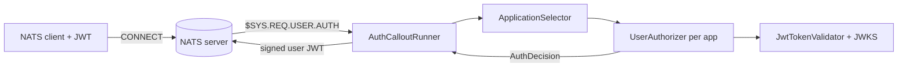

# Design: nats-auth-callout-service

A standalone [NATS auth callout](https://docs.nats.io/running-a-nats-service/configuration/securing_nats/auth_callout)
service, extracted from the `mise` API. It authenticates connecting NATS
clients with an OIDC/JWT bearer token and mints scoped NATS user JWTs with
per-application publish/subscribe permissions.

## Goals

- **Minimal.** A single console executable. No ASP.NET, no generic-host
  `BackgroundService`, no web server. It connects to NATS, subscribes to
  `$SYS.REQ.USER.AUTH`, and answers requests in an `await foreach` loop.
- **Generic.** No domain concepts (households, `mise.*` subjects) are compiled
  in. Everything is data-driven configuration.
- **Multi-application.** One callout instance can serve several applications,
  each with its own OIDC issuer, permission model, and target NATS account.

## Architecture

| Component | Responsibility |
|-----------|----------------|
| `AuthCalloutRunner` | NATS transport: subscribe, decode request, encode signed response. |
| `ApplicationSelector` | Route a connection to the right application. |
| `UserAuthorizer` | Pure decision logic for one application (fully unit-tested). |
| `JwtTokenValidator` + `JwksProvider` | Validate bearer tokens against an OIDC JWKS. |
| `AuthCalloutFactory` | Compose the graph from configuration (no DI container). |
| CLI `Program` + `Telemetry` | Config layering, OpenTelemetry, graceful run loop. |

`UserAuthorizer` and `ApplicationSelector` contain no NATS code, so the
permission logic is testable without any broker.

## Resolving mise-specific coupling

The original `NatsAuthCalloutService` in mise hard-coded several concerns. Each
is replaced with configuration:

| mise coupling (before) | Resolution (after) |
|------------------------|--------------------|
| `SubjectPrefix = "mise"` string-concatenated into every subject | Subjects are full templates in config (`mise.house.{scope}.commands`). No prefix logic in code. |
| `household_id` claim drove per-household permissions | `Authenticated.ScopeClaim` names the claim; `{scope}` placeholder expands `PublishPerScope`/`SubscribePerScope` once per claim value. |
| `sub` claim used as the user name | `Authenticated.NameClaim` is configurable. |
| `ApiUserPublicKey` service-account bypass | `Routing.ServiceAccountNKeys` per application. |
| Keycloak authority read from `Keycloak:Authority`, JWKS URL derived inline | Per-application `Jwt.Authority` / `Jwt.JwksUri`; any OIDC provider works. |
| Fixed anonymous subjects (`auth.commands`, `discovery.queries`, `_INBOX.>`) | `Anonymous.Publish` / `Anonymous.Subscribe` lists in config. |
| Single `APP` target account | Per-application `TargetAccount`. |
| Expiry constants (10 min anon, 5 min default) | `ExpirySeconds` / `FallbackExpirySeconds` in config; authenticated grants prefer the token's own `exp`. |

The mise deployment reproduces its original behavior purely through
`appsettings` (see `appsettings.Development.json`).

## Multi-application permissions

Two apps sharing one callout get independent permission sets. A connection is
routed to an application by, in precedence order:

1. **Service-account NKey** — `Routing.ServiceAccountNKeys` (also grants `>`).
2. **NATS connect username** — `Routing.ConnectUsernames` (client picks its app).
3. **Token issuer** — `Routing.TokenIssuers` matches the JWT `iss` claim.
4. **Default** — `DefaultApplication`, else the connection is denied (empty grant).

The issuer is read from the token **without validating it** purely for routing;
the selected application then fully validates the token against its own JWKS. A
valid token for application B can never be used to gain application A's subjects
(covered by `AppB_Token_CannotAccess_AppA_Subjects`).

## Why no background worker / ASP.NET

The service does exactly one thing: consume from one NATS subject and reply.
That needs a NATS connection and a loop, nothing more. A generic host or web
server would add lifecycle machinery, an idle HTTP port, and dependencies for
no benefit. The CLI wires configuration, OpenTelemetry, and a
`CancellationToken` for SIGINT/SIGTERM, then runs the loop inline.

## Signing model

A single AUTH account signing key (`IssuerSeed`) signs every minted user JWT and
the authorization response, matching the single `auth_callout { issuer }` the
NATS server is configured with. Applications differ by `TargetAccount`
(the JWT audience), not by signing key.

## Testing

- **Unit** (`NatsAuthCallout.Tests`): `UserAuthorizer` decisions, per-scope
  expansion, anonymous fallbacks, `ApplicationSelector` routing precedence,
  option validation. Uses a fake token validator and `FakeTimeProvider`.
- **Integration** (`NatsAuthCallout.IntegrationTests`): a real `nats:2-alpine`
  Testcontainer configured for auth callout, the runner in-process, and an
  in-process RS256 JWKS issuer (`TestJwtIssuer`). All NKeys are generated at
  runtime, so no secrets are committed. Two applications prove cross-app
  isolation.
