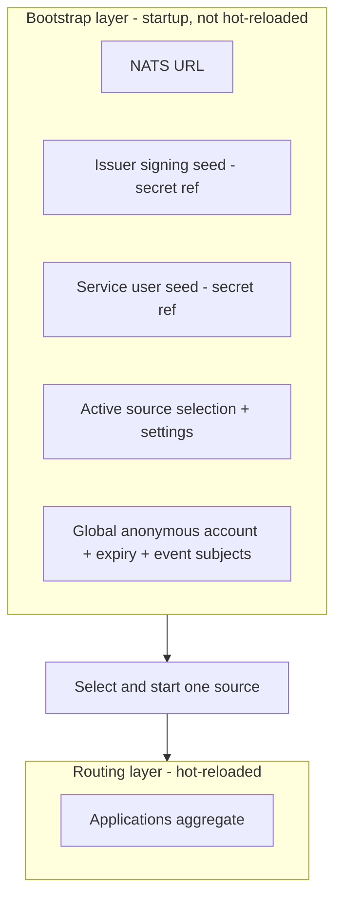

# Configuration overview

Configuration is split into two layers by lifecycle and sensitivity ([doc
04](https://github.com/ryandanthony/nats-auth-callout-service/blob/main/docs/design/04-configuration.md),
[ADR 0005](https://github.com/ryandanthony/nats-auth-callout-service/blob/main/docs/architecture-decision-log/0005-config-abstraction-and-sources.md)):



1. **[Bootstrap](./bootstrap-reference)** — how to connect and where to read
   routing config from. Loaded once at startup from a fixed file. Holds the
   sensitive seeds (as [secret references](#secret-references)) and the
   global anonymous settings. **Never hot-reloaded.**
2. **[Application](./application-reference)** (the routing layer) — the
   applications aggregate: issuers, permission profiles, claim matching,
   anonymous contributions, event subjects. Served by whichever source is
   active ([files, Kubernetes CRD, or PostgreSQL](./sources/overview)) and
   **hot-reloaded** on change.

## Reference pages

- **[Bootstrap file reference](./bootstrap-reference)** — every field in
  `schemas/config/bootstrap/v1.json`.
- **[Application file reference](./application-reference)** — every field
  in `schemas/config/application/v1.json` (shared by the files source, the
  Kubernetes CRD's `spec`, and PostgreSQL's `spec` JSONB column — all three
  map into the identical canonical model, [ADR 0007](https://github.com/ryandanthony/nats-auth-callout-service/blob/main/docs/architecture-decision-log/0007-internal-configuration-model.md)).
- **[Config sources guide](./sources/overview)** — how to run each of the
  three sources: files, Kubernetes, PostgreSQL.

:::info Reference stays in sync with the schema
CI runs [`scripts/check-config-reference-drift.py`](https://github.com/ryandanthony/nats-auth-callout-service/blob/main/docs-site/scripts/check-config-reference-drift.py)
on every build: every property declared in `schemas/config/*/v1.json` must
appear on the corresponding reference page, or the build fails. If you add a
schema field, add it here in the same change.
:::

## Secret references

Sensitive values (seeds, connection strings) are never plain strings in
config — they're a `SecretRef` with a `kind`:

| `kind` | Resolves from | Extra fields |
|--------|----------------|--------------|
| `inline` | The literal `value` in the file (dev/local use only). | `value` |
| `file` | A mounted file at `path`. | `path` |
| `k8sSecret` | A Kubernetes `Secret` named `name`, key `key`. | `name`, `key` |
| `vault` | A vault-backed secret (locator TBD by deployment). | — |

```yaml
issuerSeed: { kind: file, path: /secrets/issuer.seed }
serviceUserSeed: { kind: k8sSecret, name: callout-svc, key: seed }
```

## Validation is strict and atomic

Both file schemas reject unknown fields (`additionalProperties: false`)
except `match`/claim-match objects, which are intentionally open (arbitrary
claim paths). A batch of config (bootstrap or a routing reload) is validated
as a whole: one bad application rejects the **entire** batch, keeping the
last-good config active ([ADR 0006](https://github.com/ryandanthony/nats-auth-callout-service/blob/main/docs/architecture-decision-log/0006-config-reload-and-failure-semantics.md)).
See [Operations → Health endpoints](../operations/health-and-probes) for how
a rejected reload surfaces on `/readyz`.
