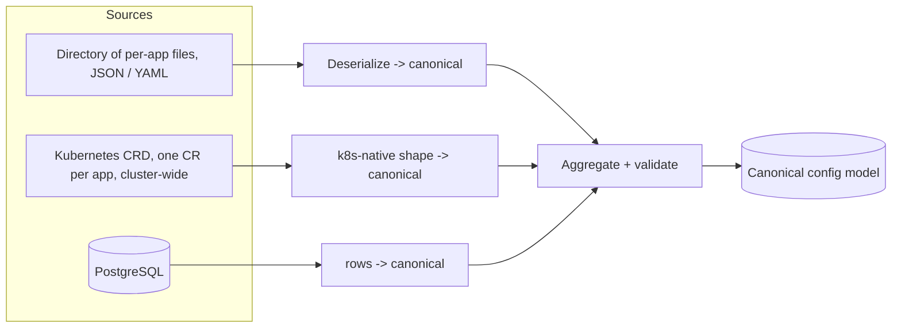

# Config sources guide

Exactly one routing source is active at a time, selected by `source.kind`
in the [bootstrap file](../bootstrap-reference#source). All three sources
map into the identical canonical model ([ADR 0007](https://github.com/ryandanthony/nats-auth-callout-service/blob/main/docs/architecture-decision-log/0007-internal-configuration-model.md)) —
switching sources never changes what an [application file](../application-reference)
looks like.



## Files {#files}

A directory of per-application JSON/YAML files, watched for changes.
Adding or removing a file adds or removes an application.

```yaml
# bootstrap.yaml
source:
  kind: files
  directory: /config/apps
  warnStaleness: 60s
  maxStaleness: 15m
  reconnectBackoff: 5s
```

Each file in `directory` is one [application file](../application-reference).
This is what the [dev loop](../../getting-started/running-the-service#local-dev-loop-aspire)
uses (`dev/AppHost.Local/config/apps/*.yaml`), with hot-reload proven live:
editing an app file while the service runs is picked up without a restart
(`FileRoutingConfigProvider`'s own watcher).

**Helm:** `source.kind=files`, with either a chart-rendered `ConfigMap`
(`source.files.configMap.create=true` + `source.files.configMap.files`) or
an operator-managed `existingConfigMap`.

## Kubernetes CRD {#kubernetes}

One `AuthApplication` Custom Resource per application
(`authcallout.ants.zone/v1`), watched **cluster-wide**. Each instance
claims only the CRs matching its own label selector, so CRs may live in
any namespace and multiple instances can share a cluster.

```yaml
apiVersion: authcallout.ants.zone/v1
kind: AuthApplication
metadata:
  name: notes
  namespace: notes
  labels:
    authcallout.ants.zone/owner: prod
spec:
  # identical shape to the application file, minus schemaVersion/name
  targetAccount: NOTES
  issuer: { authority: https://id.example.com/realms/main, jwksCache: 5m, validateAudience: true, audience: [nats] }
  profiles: [ ... ]
status:
  observedGeneration: 4
  accepted: true
  reason: ""
```

```yaml
# bootstrap.yaml
source:
  kind: k8s
  labelSelector: authcallout.ants.zone/owner=prod
  warnStaleness: 60s
  maxStaleness: 15m
  reconnectBackoff: 5s
```

The `status` subresource reports whether the CR was accepted into the
active config (`kubectl get authapplication` shows it directly). Because
reload is atomic per batch ([ADR 0006](https://github.com/ryandanthony/nats-auth-callout-service/blob/main/docs/architecture-decision-log/0006-config-reload-and-failure-semantics.md)),
one bad CR rejects the whole batch and names itself via
`status.accepted=false`.

**RBAC.** The instance needs a `ClusterRole` to `list`/`watch`
`AuthApplication` cluster-wide (and `update` its `status`).

**Helm:** `source.kind=k8s`. `source.k8s.crds.install` (default `true`)
installs the CRD itself; `source.k8s.rbac.create` (default `true`) installs
the `ServiceAccount` + `ClusterRole`/`ClusterRoleBinding`;
`source.k8s.labelSelector` sets the owner-label selector this release
claims (default `app.kubernetes.io/managed-by=nats-auth-callout`).

## PostgreSQL {#postgresql}

One row per application in `auth_applications` (name, JSONB `spec` reusing
the exact application-file schema v1 shape, `enabled`), polled on
`pollInterval` with `LISTEN`/`NOTIFY` as a latency-only optimization —
polling remains the ADR 0017 staleness heartbeat even when `NOTIFY` fires
promptly.

```yaml
# bootstrap.yaml
source:
  kind: postgres
  connectionString: { kind: k8sSecret, name: authcallout-db, key: connectionString }
  pollInterval: 30s
  notifyChannel: auth_applications_changed
  warnStaleness: 60s
  maxStaleness: 15m
  reconnectBackoff: 5s
```

Migrations are plain ordered `.sql` scripts in
[`db/migrations/`](https://github.com/ryandanthony/nats-auth-callout-service/tree/main/db/migrations).

**Helm:** `source.kind=postgres`, with `source.postgres.connectionString`
(an `existingSecret` reference), `source.postgres.pollInterval`, and
`source.postgres.notifyChannel`.

## Choosing a source

| Source | Best for | Config lives in |
|--------|----------|------------------|
| `files` | Single-instance, GitOps-managed deployments, local dev | A mounted directory / ConfigMap |
| `k8s` | Multi-team Kubernetes clusters, self-service via `kubectl apply` | `AuthApplication` Custom Resources |
| `postgres` | Central admin UI/API driving many applications, existing DB tooling | A `auth_applications` table |

All three share the same reload semantics: a bad batch is rejected whole,
last-good stays active, and staleness beyond `maxStaleness` makes the
instance not-ready without denying live traffic — see
[Operations → Health endpoints](../../operations/health-and-probes) and
[ADR 0017](https://github.com/ryandanthony/nats-auth-callout-service/blob/main/docs/architecture-decision-log/0017-watch-loss-and-connection-loss-semantics.md).
