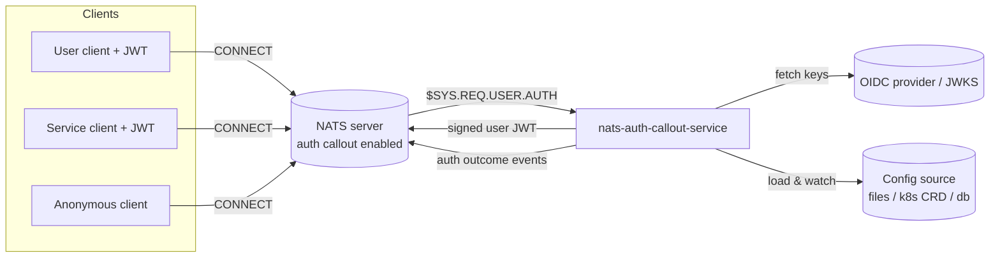

# Overview

`nats-auth-callout-service` is a standalone [NATS auth callout](https://docs.nats.io/running-a-nats-service/configuration/securing_nats/auth_callout)
service written in C# / .NET 10. It intercepts `$SYS.REQ.USER.AUTH` requests,
validates bearer tokens against configured OIDC issuers (JWKS), resolves a
grant (or denial) from a config-driven routing model, and mints signed NATS
user JWTs — so client applications authenticate against an external identity
provider (Keycloak, Auth0, Entra ID, Okta, Zitadel, Authentik, or any
compliant OIDC provider) instead of static NATS credentials.

On each connection attempt the service: identifies the issuer, validates the
token, selects an application and permission profile, mints a scoped user
JWT, persists the token for identity lookup, and emits an outcome event. See
[docs/design/01-overview.md](https://github.com/ryandanthony/nats-auth-callout-service/blob/main/docs/design/01-overview.md)
for the full component map and request lifecycle.

## What it is not

- Not an OIDC provider — it validates tokens, it never issues them.
- Not a general HTTP service — its only inbound API is `/healthz` /
  `/readyz` / `/startupz` on port `8080` for orchestrator probes.
- Not a revocation mechanism — minted user JWTs are short-lived and live
  out their TTL; there is no mid-flight revocation.

## Next steps

1. [Configure your NATS server for auth callout](./nats-server-config).
2. [Run the service](./running-the-service).
3. [Connect your first application](./first-connection).

Or jump straight to the [configuration reference](../configuration/overview)
or the [authorization model guide](../guides/authorization-model).
