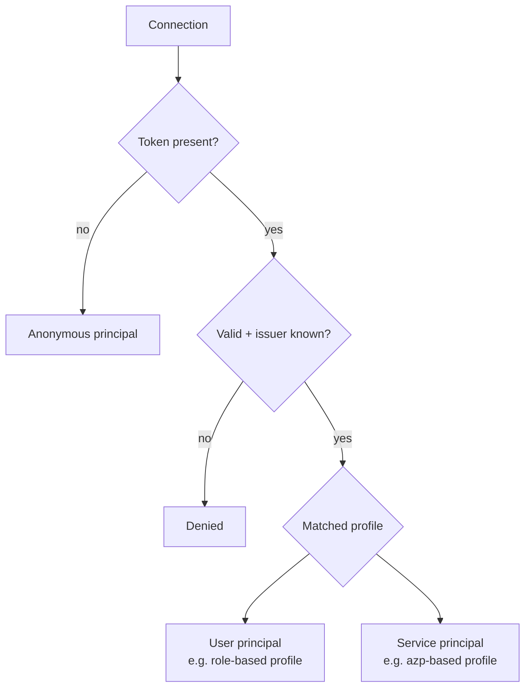
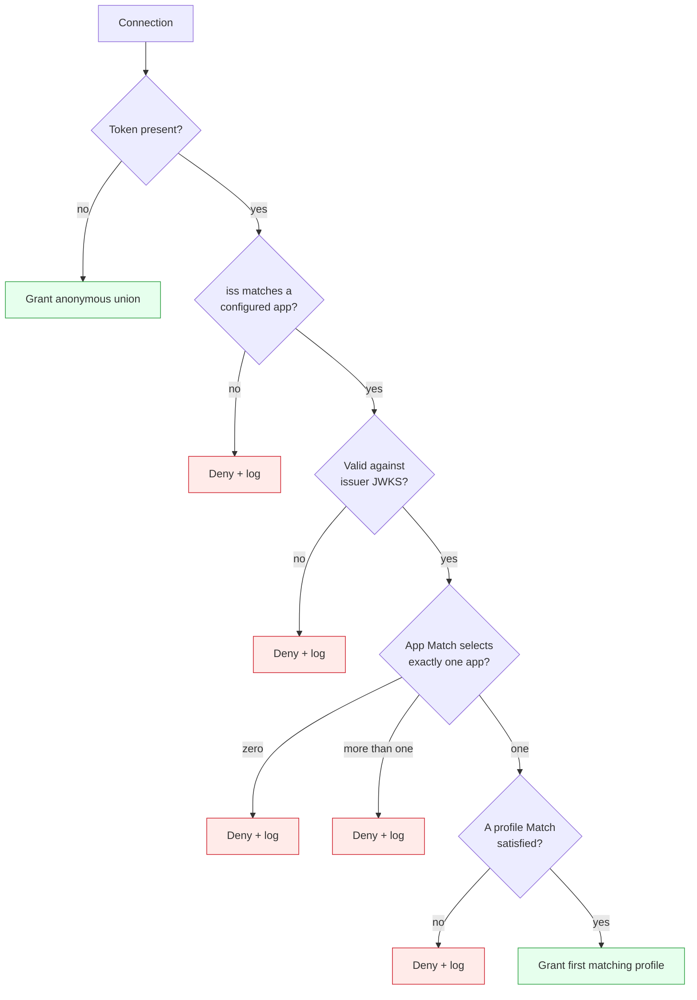
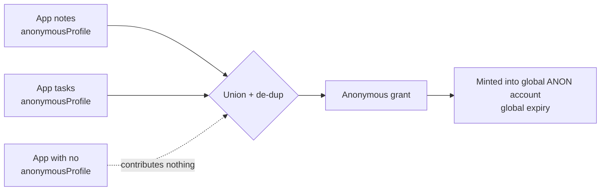

# Authorization model guide

Grounds: [ADR 0001](https://github.com/ryandanthony/nats-auth-callout-service/blob/main/docs/architecture-decision-log/0001-named-permission-profiles.md) (profiles),
[ADR 0002](https://github.com/ryandanthony/nats-auth-callout-service/blob/main/docs/architecture-decision-log/0002-service-auth-via-oidc-not-known-keys.md) (service auth),
[ADR 0003](https://github.com/ryandanthony/nats-auth-callout-service/blob/main/docs/architecture-decision-log/0003-resolution-order-issuer-validate-app-profile.md) (decision tree),
[ADR 0004](https://github.com/ryandanthony/nats-auth-callout-service/blob/main/docs/architecture-decision-log/0004-anonymous-grant-is-union-across-apps.md) (anonymous union),
[ADR 0009](https://github.com/ryandanthony/nats-auth-callout-service/blob/main/docs/architecture-decision-log/0009-templated-subject-variables.md) (templates).

## Concepts

An **application** is an independent authorization domain: one issuer, one
NATS target account, an ordered list of **profiles**, an optional
anonymous contribution, optional event subjects. Two applications are
fully isolated — a token valid for one can never yield another's subjects.

A **profile** is a named permission set inside an application, selected
when its claim `match` is satisfied. Profiles are ordered and
**first-match-wins**.

## Principals



- **User** — a human's OIDC access token; typically matched on a role
  claim (`realm_access.roles`), often combined with a per-tenant scope
  claim (e.g. `household_id`).
- **Service** — a microservice's client-credentials token; matched by a
  service-identifying claim, `azp` by default. Services get least-
  privilege scoped subjects — never a blanket grant — and there are no
  pre-shared NATS keys ([ADR 0002](https://github.com/ryandanthony/nats-auth-callout-service/blob/main/docs/architecture-decision-log/0002-service-auth-via-oidc-not-known-keys.md)).
- **Anonymous** — no token; receives the [composed anonymous grant](#anonymous-grant-is-a-union).

Users and services are not distinct code paths — just different profiles
matched on different claims.

## Claim match

A predicate over token claims, shared by application selection and
profile selection. A predicate is a map of claim path to accepted values:

- **Nested paths** are supported: `realm_access.roles`.
- **Array claims**: a path matches if the claim's values contain **any**
  listed value (OR within a key).
- **Multiple keys** must **all** match (AND across keys).
- An **empty/absent** match is only valid for an application whose issuer
  alone already identifies it uniquely.

```yaml
match:
  realm_access.roles: [notes-editor]
  azp: [notes-web]
```

## Decision tree

The authoritative outcome for any connection ([ADR 0003](https://github.com/ryandanthony/nats-auth-callout-service/blob/main/docs/architecture-decision-log/0003-resolution-order-issuer-validate-app-profile.md)):



Key rules:

- **No token** is the only non-token path, and it grants anonymous.
- **A present token that is invalid** (expired, bad signature) is denied,
  never downgraded to anonymous.
- **Ambiguity denies**: more than one matching application, or no matching
  profile, is a denial — never a union or a guess.
- **Profiles are first-match-wins**; order is the tie-breaker.

See [Troubleshooting](../troubleshooting) for the deny-reason table this
maps to.

## Templated subject variables

A profile builds dynamic subjects from **named template variables** bound
to token claims. Each variable names a placeholder, reads a claim, and
applies an ordered transform pipeline; templates reference variables by
`{name}` and may combine several.

- `variables` declare `{ name, claim, transforms, required }`.
- `publishTemplates` / `subscribeTemplates` are subject patterns with
  `{name}` placeholders, expanded by substituting each variable's
  transformed value(s), and added to the grant alongside static subjects.
- A variable bound to a multi-valued claim expands its template once per
  value; a template using several multi-valued variables expands over
  their cross-product.
- A `required` variable that resolves to no value **denies** the
  connection; a template whose variable has no value simply emits nothing.
- **Transforms** make otherwise-unsafe claim values usable in subjects
  (NATS `.`, `*`, `>`, whitespace are special): `lowercase`, `replace`,
  `sanitize`, `hash`, `prefix`/`suffix`, `require-safe` (deny on an unsafe
  result).

### Worked example

```yaml
variables:
  - name: tenant
    claim: household_id
    required: true
  - name: user
    claim: email
    transforms: [lowercase, { replace: { from: ".", to: "_" } }, { replace: { from: "@", to: "_" } }]
publishTemplates: ["mise.house.{tenant}.user.{user}.commands"]
```

A token with `household_id = [H1, H2]` and `email = Alice@Example.com`
yields:

```
mise.house.H1.user.alice_example_com.commands
mise.house.H2.user.alice_example_com.commands
```

## Anonymous grant is a union

An anonymous connection cannot be routed to any single application, so its
grant is composed from **every** application's `anonymousProfile`:



- Each application optionally contributes an `anonymousProfile`; omitting
  it is a valid opt-out.
- The effective anonymous grant is the de-duplicated union of all
  contributions.
- Because a user JWT carries one account, but the union spans applications
  with potentially different accounts, anonymous connections are minted
  into a dedicated, globally configured account
  (`anonymous.targetAccount` in the [bootstrap file](../configuration/bootstrap-reference))
  with a global expiry (`anonymous.expiry`) — anonymous grants carry no
  token `exp` to derive one from.
- Adding or removing an application automatically adds or removes its
  anonymous subjects on the next reload.
