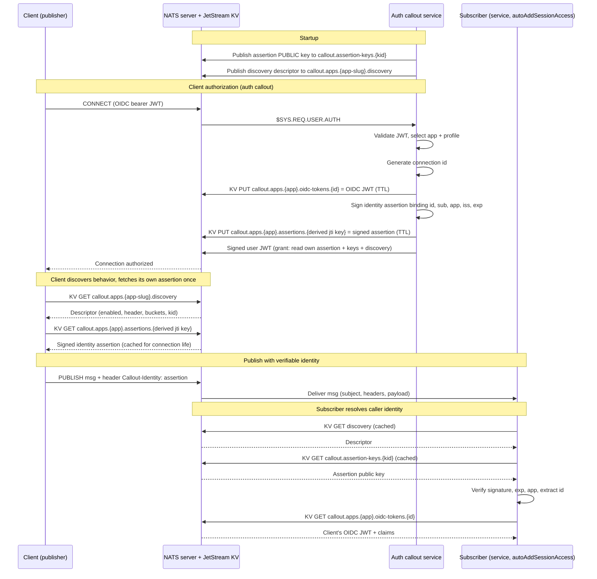
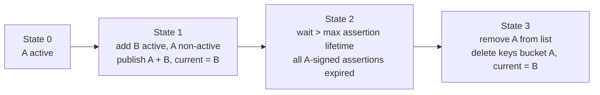

# Identity propagation guide

NATS delivers no verified publisher identity to a subscriber: a received
message exposes only its subject, headers, and payload, never the sender's
connection or token. This service propagates identity via a
**callout-signed assertion** carried in a header, verified by signature —
this is the sole identity mechanism; identity is never embedded in
subjects. Grounds: [ADR 0010](https://github.com/ryandanthony/nats-auth-callout-service/blob/main/docs/architecture-decision-log/0010-session-jwt-store-in-kv.md),
[ADR 0011](https://github.com/ryandanthony/nats-auth-callout-service/blob/main/docs/architecture-decision-log/0011-signed-identity-assertion.md),
[doc 06](https://github.com/ryandanthony/nats-auth-callout-service/blob/main/docs/design/06-identity-propagation-sequence.md).

## NuGet packages for .NET integrators

The naming rules and the verifier are published to nuget.org, so a .NET client or subscriber uses the same code as the callout itself instead of copying it:

```bash
dotnet add package AuthCallout.Identity   # brings AuthCallout.Contracts and AuthCallout.Core
```

| Package | What you use from it |
|---|---|
| `AuthCallout.Contracts` | `AppSlug`: bucket names (`DiscoveryBucket`, `AssertionsBucket`, `OidcTokensBucket`, `AssertionKeysBucket`), `DiscoveryDescriptorKey`, KV key derivation (`SanitizeKeySegment`, `DeriveKeySegment`), and `ClientInboxPrefix`. `AssertionClaims`. |
| `AuthCallout.Identity` | `AssertionSigner.Verify(compactJwt, publicKey)` to check a `Callout-Identity` header. |
| `AuthCallout.Core` | Dependency of Identity. Not normally referenced directly. |

Package versions match the service release (release `v1.2.3` publishes `1.2.3`; a release is cut on every green push to `main`). The repo's [`dev/samples/Shared`](https://github.com/ryandanthony/nats-auth-callout-service/tree/main/dev/samples/Shared) shows the full flow built on these packages: discovery, self-assertion fetch, verification and OIDC token resolution.

## The full sequence



## How to verify a `Callout-Identity` header in your subscriber

1. **Read the header.** Take `Callout-Identity` off the received message.
   A message with no valid header conveys no identity and should be
   rejected by subscribers that require it.
2. **Fetch the verification key.** Read the assertion's `kid` and
   `GET callout_assertion_keys.{kid}` from the keys bucket (cache it —
   it's read-granted to every authenticated connection unconditionally).
3. **Verify the assertion.** Check the signature against that public key,
   then validate `exp` and `app`. A forged or tampered header fails
   verification and is dropped.
4. **Extract the correlation id.** Trust the assertion's `id`/`sub`. `id`
   is the callout-generated key into the token store, not `jti` or any
   provider claim.
5. **Resolve the caller's OIDC token (only if richer claims are needed).**
   `GET callout_apps_{app-slug}_oidc_tokens.{id}` — requires your
   subscriber's profile to have `autoAddSessionAccess`.

The reference implementation is
[`dev/samples/Shared/CalloutIdentityResolver.cs`](https://github.com/ryandanthony/nats-auth-callout-service/blob/main/dev/samples/Shared/CalloutIdentityResolver.cs)
(`VerifyAsync` for steps 1-4, `ResolveOidcTokenAsync` for step 5), exercised
end to end by `TaskService`/`NoteService` in the [dev loop](https://github.com/ryandanthony/nats-auth-callout-service/blob/main/dev/README.md)
(**verified live**: signature verification + OIDC claim resolution across
a real callout, no permission violations).

```csharp
var resolver = new CalloutIdentityResolver(kv, descriptor);
var claims = await resolver.VerifyAsync(message.Headers["Callout-Identity"]);
if (claims is null)
{
    // no valid identity — treat as anonymous / reject
    return;
}
var oidcToken = await resolver.ResolveOidcTokenAsync(claims.Id); // requires autoAddSessionAccess
```

## Client connection requirements

Two things a propagation-consuming client must derive from its own token
(both via `AppSlug` helpers, mirrored in the samples' shared library):

- **Self-lookup key.** The assertion entry is keyed by the *derived* form of
  the token's `jti` (or `sub` fallback): sanitized text plus a 16-hex SHA-256
  suffix (`AppSlug.DeriveKeySegment`), so sanitization aliases of different
  principals can never collide. Use `CalloutSelfAssertion.FetchAsync` (or the
  same derivation) — never the raw `jti`.
- **Inbox prefix.** The callout grants a *scoped* reply inbox,
  `_INBOX.{app-slug}.{derived-principal}.>` — never the account-wide
  `_INBOX.>` (which would let any authenticated client read every other
  client's request replies). Set the matching custom prefix on the
  connection (`NatsOpts.InboxPrefix` in NATS.NET, `custom_inbox_prefix`
  elsewhere): `AppSlug.ClientInboxPrefix(principal)` with the token's `sub`
  (falling back to `azp`); see `CalloutInboxPrefix.For` in the samples.
  Without it, KV reads and request-replies silently time out (the reply
  subscription is denied server-side).

Responder services answering request-reply additionally need
`publish: ["_INBOX.{app-slug}.>"]` in their profile grant (publishing a
reply is a far weaker capability than subscribing to inboxes).

## Discovery descriptor

Both client and subscriber first `GET callout.apps.{app-slug}.discovery`
(cache it) to learn whether propagation is enabled and, if so, the header
name, bucket names, and current `kid` — never hard-code these.

```json
{
  "schemaVersion": 1,
  "app": "notes",
  "identityPropagation": {
    "enabled": true,
    "header": "Callout-Identity",
    "oidcTokenBucket": "callout_apps_notes_oidc_tokens",
    "assertionBucket": "callout_apps_notes_assertions",
    "assertionKeysBucket": "callout_assertion_keys",
    "currentKid": "2026-09-06a"
  }
}
```

If `enabled: false`, the client attaches no header and the subscriber
expects none — this is a per-application toggle, default enabled
([ADR 0012](https://github.com/ryandanthony/nats-auth-callout-service/blob/main/docs/architecture-decision-log/0012-identity-propagation-toggle-and-discovery.md)).
The reference fetch is
[`dev/samples/Shared/CalloutDiscovery.cs`](https://github.com/ryandanthony/nats-auth-callout-service/blob/main/dev/samples/Shared/CalloutDiscovery.cs).

## Key rotation runbook

Assertion keys rotate as a **keyset edit + restart** (the bootstrap layer
is never hot-reloaded), per [ADR 0014](https://github.com/ryandanthony/nats-auth-callout-service/blob/main/docs/architecture-decision-log/0014-key-rotation-orchestration.md):



1. **Add + promote.** In the bootstrap `assertionKeys` list, add key `B`
   with `active: true` and flip `A` to `active: false`. Restart. The
   callout now signs new assertions with `B`, keeps publishing both `A`
   and `B`'s public keys, and points `current` at `B`.
2. **Overlap.** Wait at least the maximum assertion lifetime (aligned to
   the token/grant lifetime) — assertions signed with `A` keep verifying
   because `A` is still published.
3. **Retire.** Remove `A` from the list entirely and restart. The callout
   deletes `callout_assertion_keys.A`. Any straggler `A`-signed assertion
   now fails verification (fail-closed — expected).

**Emergency rotation** (suspected compromise): skip the overlap and remove
the bad key immediately. Its outstanding assertions are invalidated
immediately — this is the intended fail-closed behavior.

Issuer-seed rotation (the NATS `auth_callout.issuer` key) is a separate,
server-coordinated procedure: configure the server to trust both old and
new issuer public keys, roll the callout to the new seed, then remove the
old key from server config once no user JWTs signed by it remain (bounded
by user-JWT TTL). See [ADR 0014](https://github.com/ryandanthony/nats-auth-callout-service/blob/main/docs/architecture-decision-log/0014-key-rotation-orchestration.md#issuer-seed-rotation-server-coupled)
for the full procedure — it is intentionally not automated.
