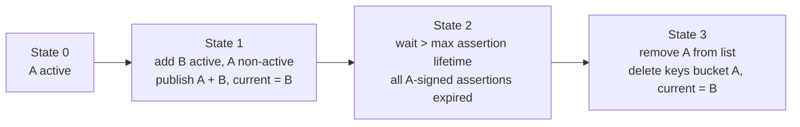

# 0014 — Key rotation orchestration

- **Status:** proposed
- **Date:** 2026-09-06
- **Deciders:** Ryan

## Context

The service holds two signing keys with very different rotation semantics:

- The **assertion signing key** ([ADR 0011](./0011-signed-identity-assertion.md)): signs identity assertions; its public half is published to the keys bucket (`callout_assertion_keys`, [ADR 0013](./0013-kv-bucket-naming-contract.md)) for verifiers. It rotates independently of NATS ([ADR 0007](./0007-internal-configuration-model.md)).
- The **issuer signing seed**: the NATS account signing key configured as the `auth_callout` issuer on the server; signs minted user JWTs and the authorization response.

[05 — Runtime and lifecycle](../design/05-runtime-and-lifecycle.md) states the assertion key rotates independently but does not define the mechanism: what triggers a rotation, how a new key overlaps the old so in-flight assertions still verify, and when an old key may be removed. It also leaves issuer-seed rotation undefined, which is riskier because it is coupled to server config. This ADR defines both.

## Decision

### Assertion keys are a keyset, not a single key

The bootstrap config holds a **list of assertion keys** rather than one. Each entry is `{ kid, key: SecretRef, active: bool }`. Exactly **one** entry is marked `active`.

- **Active key** — the single key used to **sign** newly minted assertions. Its `kid` is stamped in each assertion header.
- **Non-active keys** — kept in the list purely for **verification**. Their public halves remain published so assertions signed before the last rotation still verify.
- **Removal = retiring.** Deleting an entry from the list is how a key is retired. It stops being published and its assertions can no longer be verified.

Validation (fail closed): exactly one `active` entry, `kid`s unique, every referenced `SecretRef` resolves. Zero or multiple actives is a rejected config.

### What the callout publishes

On startup and whenever the keyset changes, the callout reconciles the keys bucket to the list:

- For **every** key in the list (active and non-active), publish its **public** key at `callout_assertion_keys.{kid}` ([ADR 0013](./0013-kv-bucket-naming-contract.md)). Never publish seeds.
- Point `callout_assertion_keys.current` at the **active** `kid`.
- **Delete** keys-bucket entries whose `kid` is no longer in the list (retirement).

Verifiers fetch `callout_assertion_keys.{kid}` by the `kid` in the assertion header and cache it ([ADR 0011](./0011-signed-identity-assertion.md)); `current` is only a convenience pointer to the active signer.

### Rotation procedure (assertion key)

Rotation is a keyset edit, applied through the normal config path (bootstrap reload / restart). The overlap window is created by keeping the old key non-active before removing it:

1. **Add + promote.** Add key `B` with `active: true` and flip `A` to `active: false`. The callout signs new assertions with `B`, keeps publishing both `A` and `B`, and points `current` at `B`.
2. **Overlap.** Assertions signed with `A` keep verifying because `A` is still published. The overlap must last at least the **maximum assertion lifetime** (aligned to the token/grant lifetime, [ADR 0011](./0011-signed-identity-assertion.md)); until then `A` stays in the list, non-active.
3. **Retire.** After the overlap, remove `A` from the list. The callout deletes `callout_assertion_keys.{A}`. Any straggler assertion signed by `A` (should be none) fails verification and is rejected, fail closed.

Emergency rotation (suspected compromise) is the same edit with the overlap skipped: remove the bad key immediately and accept that its outstanding assertions are invalidated. That is the intended fail-closed behavior for a compromised key.

### Rotation trigger

- **Routine:** operator-driven keyset edit (calendar or policy). No automatic time-based rotation in v1; the keyset makes manual rotation safe and auditable.
- **Reconciliation:** the callout treats the keyset as desired state and reconciles the keys bucket on every startup and keyset change, so a restart after a partial rotation self-heals.

### Issuer seed rotation (server-coupled)

The issuer seed is **not** in the assertion keyset and cannot rotate purely in-band, because the NATS server's `auth_callout` config pins the issuer public key. Rotation is a coordinated, operator-run change:

1. Configure the NATS server to trust **both** the old and new issuer public keys for auth callout (server supports multiple auth users / signing keys).
2. Roll the callout to sign with the **new** issuer seed (bootstrap secret change + restart).
3. Once no user JWTs signed by the old seed remain (bounded by user-JWT TTL), remove the old issuer key from the server config.

Minted user JWTs are short-lived and cannot be revoked ([05](../design/05-runtime-and-lifecycle.md)), so the bound is simply the JWT TTL. This ADR records the coupling and the ordering; the server-side change is out of the service's control and must be done by whoever manages the NATS server config.

## Consequences

- Assertion-key rotation is a declarative keyset edit: add-and-promote, wait the overlap, remove. No bespoke rotation state machine.
- "One active, rest verify-only, removal = retire" gives a clear, auditable model and a natural overlap window without a separate "grace" flag.
- The callout reconciles the keys bucket (publish present keys, delete absent ones) so the bucket always mirrors the configured list; restarts are idempotent.
- Retiring a key before the overlap elapses invalidates its live assertions (fail closed) — this is deliberate for compromise, and a validation-time warning could flag premature removal, but the config is still honored.
- Issuer-seed rotation stays a documented, server-coordinated operator procedure; the service only changes which seed it signs with. It is intentionally not automated.
- Requires the bootstrap model to carry an assertion **keyset** (list) instead of a single `assertionKey` ([ADR 0007](./0007-internal-configuration-model.md) / [04 — Configuration](../design/04-configuration.md) updated accordingly).

## Related

- Design: [04 — Configuration](../design/04-configuration.md) (bootstrap keyset), [05 — Runtime and lifecycle](../design/05-runtime-and-lifecycle.md) (signing, independent rotation), [07 — KV storage](../design/07-kv-storage.md) (keys bucket).
- ADRs: [0007](./0007-internal-configuration-model.md) (assertion signing key in config), [0011](./0011-signed-identity-assertion.md) (assertion, `kid`, keys bucket, `current` pointer), [0013](./0013-kv-bucket-naming-contract.md) (keys-bucket physical name).
