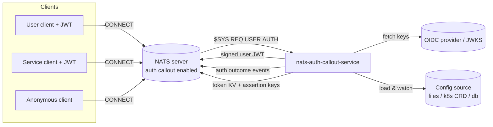
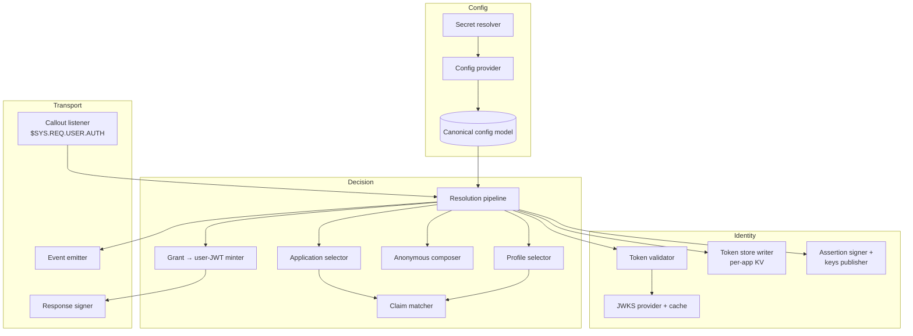
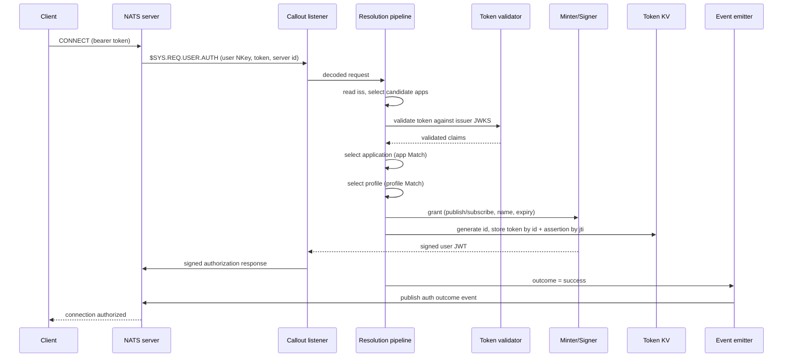

# 01 — Overview

## Context

The service sits between a NATS server and one or more identity providers. NATS is configured with auth callout enabled, delegating every client authorization to this service. Clients present OIDC access tokens (users) or client-credentials tokens (services) issued by an OIDC provider such as Keycloak.

**Provider neutrality.** The design targets standard OIDC/JWT only: issuer discovery via `.well-known/openid-configuration`, JWKS signature validation, and standard/registered or configurable claims. Keycloak is used throughout only as a running example (e.g. `azp`, `realm_access.roles`); nothing is hard-coded to it. Any compliant OIDC provider (Auth0, Entra ID, Okta, Zitadel, Authentik, ...) works by configuring each application's `authority` and the claims its `Match`/variables read.

The service's job on each request: identify the issuer, validate the token, select the application and permission profile, mint a scoped user JWT, persist the token for identity lookup, and emit an outcome event.

## Responsibilities

In scope:

- Respond to `$SYS.REQ.USER.AUTH` with a signed NATS user JWT.
- Validate OIDC/JWT bearer tokens against per-issuer JWKS.
- Route each connection to an application and a permission profile from configuration.
- Grant anonymous connections a composed, cross-application permission set.
- Publish per-application auth outcome events.
- Persist each authenticated connection's OIDC token to a per-application KV so services can resolve caller identity, and publish the assertion verification key.
- Load configuration from a pluggable source and reload it safely.

Out of scope:

- Issuing or managing OIDC tokens (the identity provider does this).
- Being an HTTP/web service. It has no inbound API surface beyond NATS.
- Revoking already-minted user JWTs (they live out their short TTL).

## Component map

The design separates transport, decision logic, identity, and configuration so each can be reasoned about and tested independently.

| Component | Responsibility |
|-----------|----------------|
| Callout listener | Subscribe to `$SYS.REQ.USER.AUTH`, decode each request. |
| Response signer | Encode and sign the user JWT and the authorization response. |
| Event emitter | Publish best-effort auth outcome events. |
| Resolution pipeline | Orchestrate issuer → validate → app → profile → mint. |
| Application selector | Pick the application from issuer + app-level claim match. |
| Profile selector | Pick the first matching profile within the application. |
| Claim matcher | Evaluate claim predicates (shared by app and profile selection). |
| Anonymous composer | Build the union grant for anonymous connections. |
| Grant → user-JWT minter | Turn a grant into signed NATS user permissions. |
| Token validator | Validate a token against its issuer's JWKS. |
| JWKS provider | Fetch and cache signing keys per issuer. |
| Token store writer | Generate the connection id and persist the OIDC token and signed assertion to the per-application KV buckets (ADR 0010). |
| Assertion signer + keys publisher | Sign identity assertions and publish the verification key to the keys bucket (ADR 0011). |
| Config provider | Load, aggregate, watch, and validate the routing config. |
| Canonical config model | The single in-memory shape all sources map into. |
| Secret resolver | Resolve secret references for sensitive values. |

The Decision components contain no transport or storage code, so the whole authorization model is exercisable in isolation.

## Request lifecycle (happy path)

Non-happy paths (no token, invalid token, no match, ambiguity) are covered by the decision tree in [02-authorization-model.md](./02-authorization-model.md) and the pipeline in [03-resolution-pipeline.md](./03-resolution-pipeline.md).
