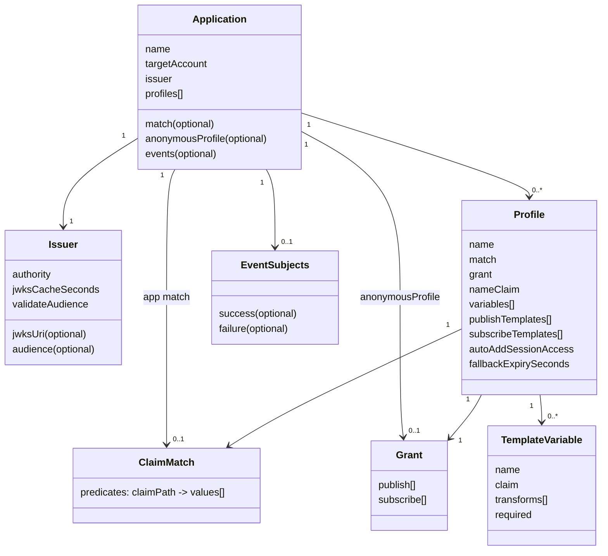
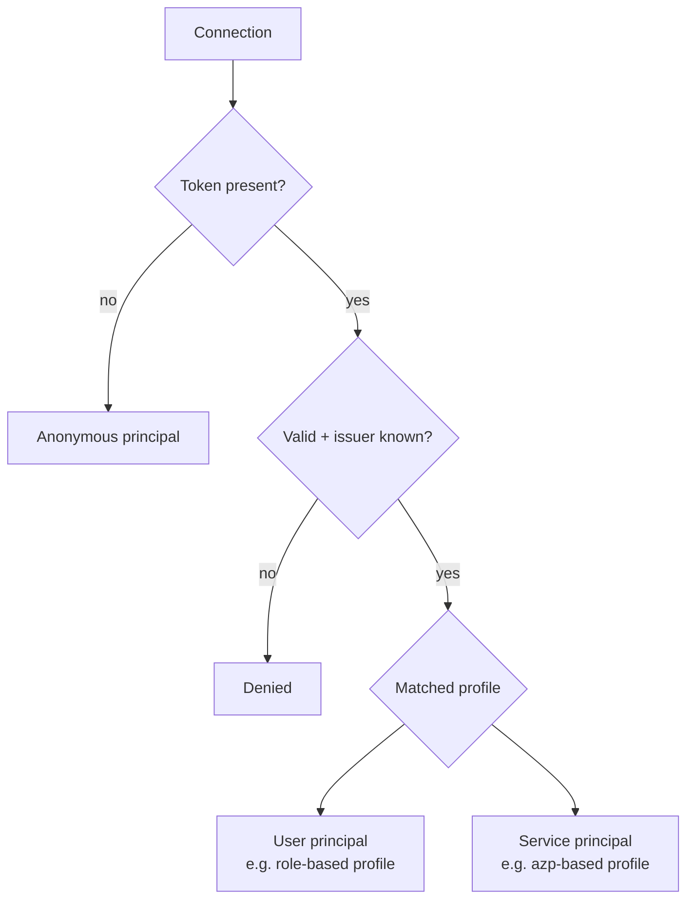
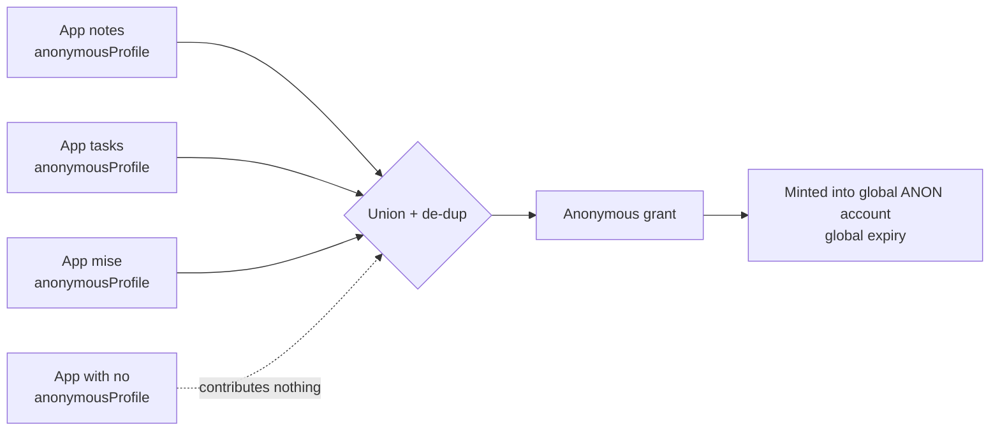
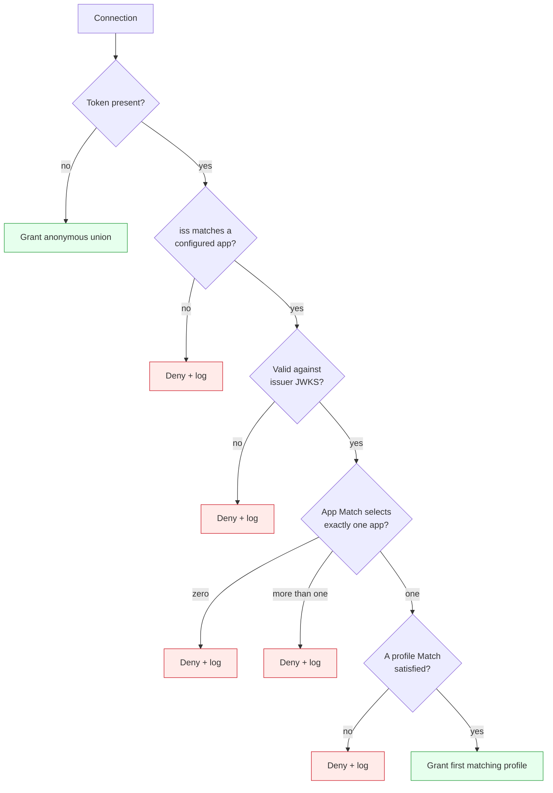

# 02 — Authorization model

Grounds: ADR 0001 (profiles), ADR 0002 (service auth), ADR 0004 (anonymous union), and the decision tree from ADR 0003.

## Concepts



### Application

An independent authorization domain. It owns an issuer, a NATS target account, an ordered list of permission profiles, an optional anonymous contribution, and optional event subjects. Two applications are fully isolated: a token valid for one can never yield another's subjects.

### Issuer

The OIDC authority whose JWKS validates the application's tokens. The `iss` claim both selects candidate applications and chooses the signing keys. Audience *validation* is a separate, independent setting from audience-based routing.

### Profile

A named permission set inside an application, selected when its claim `Match` is satisfied by a validated token. A profile can grant static subjects and templated subjects (see below), and may opt into token-store access (`autoAddSessionAccess`, see [Identity propagation](#identity-propagation-adr-0010-0011)). Profiles are ordered.

### Grant

A pair of publish and subscribe subject-pattern lists. The unit of permission, reused by profiles and by anonymous contributions.

### Claim match

A predicate over token claims, shared by application selection and profile selection. A predicate is a map of claim path to accepted values:

- **Nested paths** are supported (e.g. `realm_access.roles`).
- **Array claims** are supported: a path matches if the claim's values contain any listed value (**OR within a key**).
- **Multiple keys** must all match (**AND across keys**).
- An **empty/absent** match is only valid for an application whose issuer alone already identifies it uniquely.

## Principals

The model recognizes three kinds of principal, all expressed through the same mechanisms:



- **User** — a human's OIDC access token; typically matched by a role claim, often using a scope claim (e.g. `household_id`) for per-tenant subjects.
- **Service** — a microservice's client-credentials token; matched by a service-identifying claim, `azp` by default (configurable). Services get least-privilege scoped subjects, never a blanket grant, and there are no pre-shared NATS keys (ADR 0002).
- **Anonymous** — no token; receives the composed anonymous grant.

Users and services are not distinct code paths. They are just different profiles matched on different claims.

## Templated subject variables

A profile builds dynamic subjects from **named template variables** bound to token claims (ADR 0009). Each variable names a placeholder, reads a claim, and applies an ordered transform pipeline; templates reference variables by `{name}` and may combine several.

- `variables` declare `{ name, claim, transforms, required }`.
- `publishTemplates` / `subscribeTemplates` are subject patterns with `{name}` placeholders, expanded by substituting each variable's transformed value(s), and added to the grant alongside the static subjects.
- A variable bound to a multi-valued claim expands its template once per value; a template using several multi-valued variables expands over their cross-product.
- A `required` variable that resolves to no value denies the connection; a template whose variable has no value simply emits nothing.
- Transforms make otherwise unsafe claim values usable in subjects (NATS `.`, `*`, `>`, whitespace are special). Steps include `lowercase`, `replace`, `sanitize`, `hash`, `prefix`/`suffix`, and `require-safe` (deny on an unsafe result). The `{scope}` single-claim form is just one variable named `scope`.

Example: variables `tenant := household_id` and `user := email | lowercase | replace(. -> _) | replace(@ -> _)`, with template `mise.house.{tenant}.user.{user}.commands`. A token with `household_id = [H1, H2]` and `email = Alice@Example.com` yields `mise.house.H1.user.alice_example_com.commands` and `mise.house.H2.user.alice_example_com.commands`.

## Identity propagation (ADR 0010, 0011)

NATS delivers no verified publisher identity to a subscriber: a received message exposes only its subject, headers, and payload, never the sender's connection or token. The connecting principal's identity is propagated by a **callout-signed assertion** carried in a header, verified by signature. This is the sole identity mechanism; identity is never embedded in subjects.

At authorization the callout:

- **Generates an `id`** (a high-entropy value it controls, not a token claim) for the connection.
- Writes the client's **OIDC access token** to `callout.apps.{app-slug}.oidc-tokens.{id}`, TTL matched to the token lifetime.
- Signs an **identity assertion** binding that `id` (plus `sub`, `app`, `iss`, `exp`) and stores it at `callout.apps.{app-slug}.assertions.{jti}`, so the client can find its own assertion using the `jti` it already knows.
- Grants the client read of only its own `callout.apps.{app-slug}.assertions.{jti}` entry and read of the keys bucket; grants service profiles with `autoAddSessionAccess` read of the whole `callout.apps.{app-slug}.oidc-tokens.>` bucket.

```mermaid
flowchart LR
  callout[Callout] -->|store OIDC token by id| tok[(KV callout.apps.{app-slug}.oidc-tokens)]
  callout -->|store signed assertion by jti| ids[(KV callout.apps.{app-slug}.assertions)]
  callout -->|publish public key| keys[(KV callout.assertion-keys)]
  client[Client] -->|GET own assertion by jti| ids
  client -->|publish with Callout-Identity header| nats[(NATS)]
  nats --> svc[Service session with autoAddSessionAccess]
  svc -->|verify assertion with public key| keys
  svc -->|GET OIDC token by id| tok
  tok -->|OIDC JWT + claims| svc
```

Client: sign in, receive the grant, `GET callout.apps.{app-slug}.assertions.{jti}` once to fetch its signed assertion, cache it, and attach it as the `Callout-Identity` header on published messages.

Subscriber: fetch the assertion verification key from the keys bucket (cached), verify the `Callout-Identity` signature plus `exp` and `app`, extract the `id`, `GET callout.apps.{app-slug}.oidc-tokens.{id}`, and use the OIDC JWT to decide.

Trust comes from the callout's signature, not the subject. A generated `id` (not `jti` or any provider claim) is the correlation key, so the design is provider-neutral. `jti` is used only as the client's self-lookup key in `callout.apps.{app-slug}.assertions`. Identity headers use the `Callout-` prefix, never the reserved `Nats-` prefix. Anonymous connections select no application and get no token record or assertion.

Identity propagation is a **per-application toggle** (ADR 0012), default enabled. A disabled application does none of the token/assertion storage and grants no keys-bucket read. Clients and subscribers discover an application's behavior at runtime by reading a discovery descriptor at `callout.apps.{app-slug}.discovery` (readable by any authenticated connection), which reports `enabled` plus the header, bucket names, and current `kid`. See [07 — KV storage](./07-kv-storage.md) for the authoritative bucket reference.

## Anonymous grant is a union (ADR 0004)

An anonymous connection cannot be routed to any single application, so its grant is composed from every application:



- Each application optionally contributes an `anonymousProfile`; omitting it is a valid opt-out.
- The effective anonymous grant is the de-duplicated union of all contributions.
- Because a user JWT carries one account but the union spans applications with potentially different accounts, anonymous connections are minted into a dedicated, globally configured account with a global expiry.
- Adding or removing an application automatically adds or removes its anonymous subjects.

## Decision tree (ADR 0003)

The authoritative outcome for any connection:



Key rules:

- **No token** is the only non-token path, and it grants anonymous.
- **A present token that is invalid** (expired, bad signature) is denied, never downgraded to anonymous.
- **Ambiguity denies**: more than one application or an unresolvable profile is a denial, not a union or a guess.
- **Profiles are first-match-wins**; order is the tie-breaker and multiple matches are not an error.
- Every denial emits a clear log and (where configured) a failure event.
