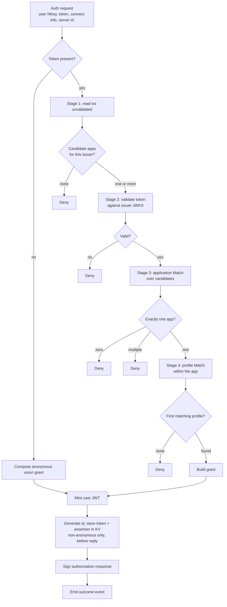
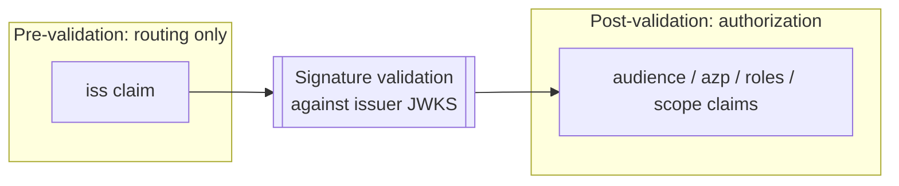
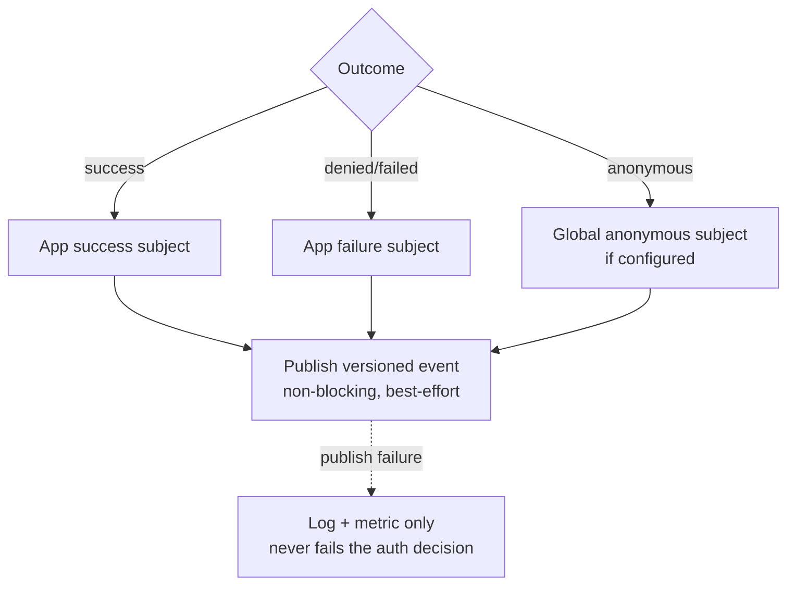

# 03 — Resolution pipeline

Grounds: [ADR 0003](../architecture-decision-log/0003-resolution-order-issuer-validate-app-profile.md) (resolution order), [ADR 0001](../architecture-decision-log/0001-named-permission-profiles.md) / [ADR 0002](../architecture-decision-log/0002-service-auth-via-oidc-not-known-keys.md) (selection targets), [ADR 0009](../architecture-decision-log/0009-templated-subject-variables.md) (subject variables), [ADR 0008](../architecture-decision-log/0008-publish-auth-outcome-events.md) (events), [ADR 0010](../architecture-decision-log/0010-session-jwt-store-in-kv.md) / [ADR 0011](../architecture-decision-log/0011-signed-identity-assertion.md) (identity). This is the runtime path for a single auth request.

## Why this order

The `iss` claim selects the JWKS used to verify the token. Therefore issuer must be read first, and no other claim can be trusted until validation succeeds. Claim-based application and profile selection are strictly *post-validation* stages. The pipeline is fixed and the same for every principal.

## Stages

### Stage 1 — Issuer (pre-validation)

Read `iss` from the token without trusting it. Look up the set of applications configured with that authority. This set is the candidate list, and it also identifies the single JWKS/authority to validate against (candidates on one authority share it). No candidates → deny.

### Stage 2 — Validate

Verify the token's signature, expiry, and issuer against the issuer's JWKS, once. Optionally verify audience if the application enables audience validation (this is independent of using audience for routing). Failure → deny. Success yields a trusted claim set.

### Stage 3 — Application selection

Among the issuer's candidates, evaluate each application's optional claim `Match`:

- Exactly one match → that application.
- A single candidate with no `Match` (issuer alone is unique) → that application.
- Zero matches → deny.
- More than one match → deny (no union across accounts, no tie-breaker).

### Stage 4 — Profile selection

Within the chosen application, evaluate profiles in order and take the **first** whose `Match` is satisfied. No profile matches → deny.

### Grant construction

From the selected profile (or the anonymous union):

- Start from the static `publish` / `subscribe` subjects.
- Resolve the profile's template variables from validated claims, applying each variable's transform pipeline, then expand `publishTemplates` / `subscribeTemplates` (per-value, cross-product across multi-valued variables). A `required` variable with no value denies; an unsafe transformed value denies (ADR 0009).
- Determine the minted JWT `name` from the profile's name claim.
- Determine expiry from the token's own `exp` (always present: validation requires an expiration time, ADR 0016); anonymous uses the global anonymous expiry.
- Target account: the application's account, or the global anonymous account for anonymous.
- If the profile sets `autoAddSessionAccess`, add read permission for the application's token KV bucket (`callout.apps.{app-slug}.oidc-tokens.>`) to the grant (ADR 0010).
- Every authenticated (non-anonymous) grant also gets read access to the keys bucket (`callout.assertion-keys.>`) and to this application's discovery entry (`callout.apps.{app-slug}.discovery`), **regardless of the application's identity-propagation toggle** (ADR 0011, 0012), so it can verify identity assertions and discover the application's propagation behavior at runtime; anonymous grants get neither. When the application disables identity propagation, `autoAddSessionAccess` on its profiles is a config error (ADR 0012), but the keys and discovery reads are still added.

### Store identity (ADR 0010, 0011)

On a successful (non-anonymous) grant for an application with identity propagation **enabled** (ADR 0012), and **before replying**, the callout **generates the connection's `id`**, writes the client's OIDC access token to `callout.apps.{app-slug}.oidc-tokens.{id}`, signs an identity assertion binding that `id`, and stores the assertion at `callout.apps.{app-slug}.assertions.{jti}` for client self-lookup. TTLs match the token lifetime; a reconnect is a new authorization with a new `id`. When the application disables identity propagation, none of this happens. Storing before the response is what lets a client `GET` its own assertion immediately after connecting (see [02 — Authorization model](./02-authorization-model.md#identity-propagation-adr-0010-0011)).

### Mint and respond

Encode a NATS user JWT carrying the account (audience), name, expiry, and publish/subscribe allow lists, signed with the issuer signing seed. Wrap it in a signed authorization response (subject = the request's user NKey, audience = the requesting server's id) and reply on the callout subject.

## Trust boundary

Only `iss` is used before validation, and only to choose candidates and keys. An attacker can pick which application validates their token, but cannot pass that application's validation unless the token is genuinely valid for its issuer. Cross-application escalation is therefore impossible.

## Outcome events (ADR 0008)

After the decision, the pipeline emits a best-effort outcome event:

- Success events go to the selected application's success subject; denials/ failures to its failure subject.
- Anonymous outcomes use the globally configured subjects, and are off unless configured.
- Publishing never blocks or fails the auth response. Events are a versioned JSON payload carrying no secrets or raw tokens (schema in [05-runtime-and-lifecycle.md](./05-runtime-and-lifecycle.md)).
