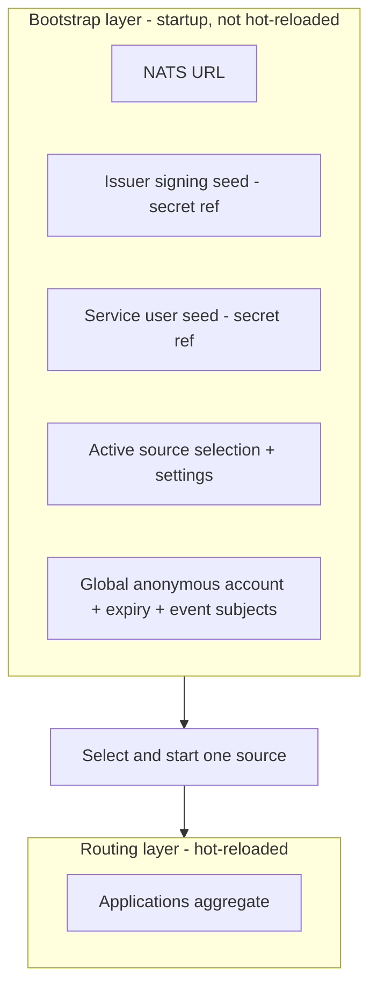
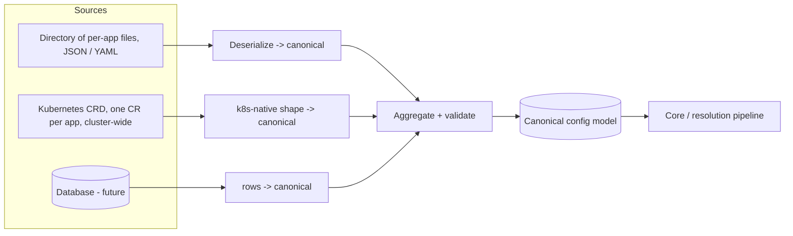
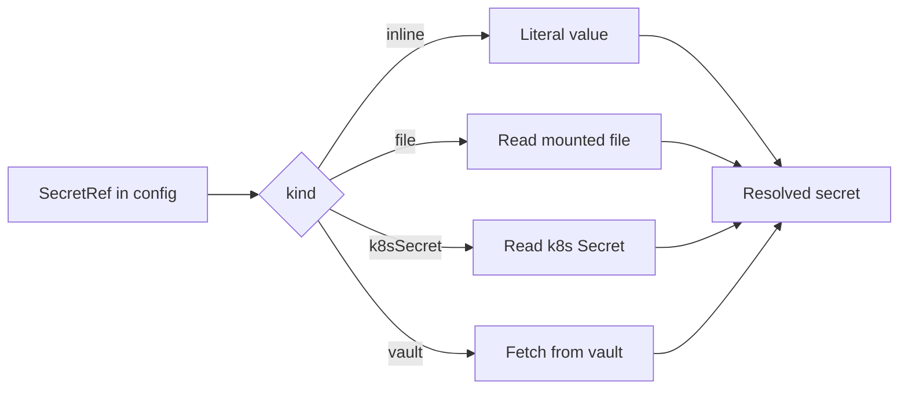

# 04 — Configuration

Grounds: [ADR 0005](../architecture-decision-log/0005-config-abstraction-and-sources.md) (sources), [ADR 0007](../architecture-decision-log/0007-internal-configuration-model.md) (canonical model), [ADR 0009](../architecture-decision-log/0009-templated-subject-variables.md) (profile variables), [ADR 0006](../architecture-decision-log/0006-config-reload-and-failure-semantics.md) (secrets resolution feeds reload, detailed in [05 — Runtime and lifecycle](./05-runtime-and-lifecycle.md)).

## Two layers

Configuration is split by lifecycle and sensitivity.

1. **Bootstrap layer** — how to connect and where to read routing config from. Loaded once at startup from a simple fixed source. Holds the sensitive seeds (as secret references) and the global anonymous settings. Not hot-reloaded.
2. **Routing layer** — the applications aggregate (issuers, profiles, anonymous contributions, event subjects). Served by a pluggable, auto-refreshing provider.

## Provider abstraction

Exactly one routing source is active at a time. Every source implements a common provider contract and maps its own external shape into the single canonical model, so the core is storage-agnostic.

Common provider contract (conceptual): *load the current set, aggregate into the canonical model, validate, and notify the core on change.* No source-specific type ever reaches the core.

### Sources

- **Files (JSON/YAML):** a directory of per-application files. Adding or removing a file adds or removes an application. Watched for change.
- **Kubernetes:** a k8s-native CRD, one Custom Resource per application, watched **cluster-wide**. Each instance claims the Custom Resources it owns by a matching label/selector, so CRs may live in any namespace and multiple instances can share a cluster. The k8s integration is isolated so its client dependency stays out of the core.
- **Database (future):** rows map into the same application aggregate; no core change needed to add it.

All sources share one aggregation model: config is a **set of discrete application units** plus the bootstrap global settings.

## Canonical model (ADR 0007)

The single shape the core consumes. Language-agnostic field view:

**Bootstrap**

- `natsUrl`
- `issuerSeed: SecretRef`
- `serviceUserSeed: SecretRef?`
- `assertionKey: SecretRef?` (signs identity assertions, ADR 0011)
- `source`: which provider + its settings (directory path, CRD selector, or DB connection)
- `anonymous`: `{ targetAccount, expirySeconds, events?: EventSubjects }`

**Routing aggregate**

- `applications: Application[]`

**Application**

- `name` (unique across the aggregate)
- `targetAccount`
- `issuer`: `{ authority, jwksUri?, jwksCacheSeconds, validateAudience, audience? }` — `jwksUri` is an optional override; otherwise it is resolved from the provider's OIDC discovery document (`{authority}/.well-known/openid-configuration`), so no provider-specific URL layout is assumed
- `match?: ClaimMatch` (app selector among same-issuer candidates)
- `anonymousProfile?: Grant` (contribution to the anonymous union)
- `profiles: Profile[]` (ordered)
- `identityPropagation?: { enabled }` (per-app toggle, default enabled; ADR 0012)
- `events?: EventSubjects`

**Profile**

- `name`
- `match: ClaimMatch`
- `grant: Grant` (static subjects)
- `nameClaim`
- `variables: TemplateVariable[]`
- `publishTemplates[]`, `subscribeTemplates[]` (use `{name}` placeholders)
- `autoAddSessionAccess` (grant read of `callout.apps.{app-slug}.oidc-tokens.>`, ADR 0010)
- `fallbackExpirySeconds`

**TemplateVariable**

- `name` (the `{name}` placeholder)
- `claim` (claim path, nested supported)
- `transforms[]` (ordered: lowercase, replace, sanitize, hash, prefix/suffix, require-safe, ...)
- `required`

**Shared types**

- `Grant`: `{ publish[], subscribe[] }`
- `ClaimMatch`: `{ claimPath -> values[] }` (nested paths, array-contains, OR within a key, AND across keys)
- `EventSubjects`: `{ success?, failure? }` (explicit subjects only)
- `Transform`: a named step (`lowercase`, `uppercase`, `replace`, `sanitize`, `hash`, `prefix`, `suffix`, `require-safe`); fixed set, not arbitrary code
- `SecretRef`: `{ kind: inline | file | k8sSecret | vault, ...locator }`

### Derived, not stored

- The effective anonymous grant (de-duplicated union of all `anonymousProfile`s).
- The issuer → candidate-applications index and JWKS handles.
- These are computed from `applications`, never authored.

## Secrets

Sensitive values are **secret references**, resolved separately from plain config:

Inline literals remain supported for simple or local use. Secret references keep seeds and future connection strings out of plain config.

## Validation

Before any config (bootstrap or a routing batch) is accepted it must pass:

- Unique application names across the aggregate.
- No two applications indistinguishable by issuer + `match`.
- Every profile has a `match`.
- No profile sets `autoAddSessionAccess` in an application whose `identityPropagation.enabled` is false (nothing to read; ADR 0012).
- Subject templates are well-formed: every `{name}` resolves to a declared variable, every variable's claim path is valid, and every transform is known.
- All secret references resolve.

Validation outcomes and reload behavior are in [05-runtime-and-lifecycle.md](./05-runtime-and-lifecycle.md).
