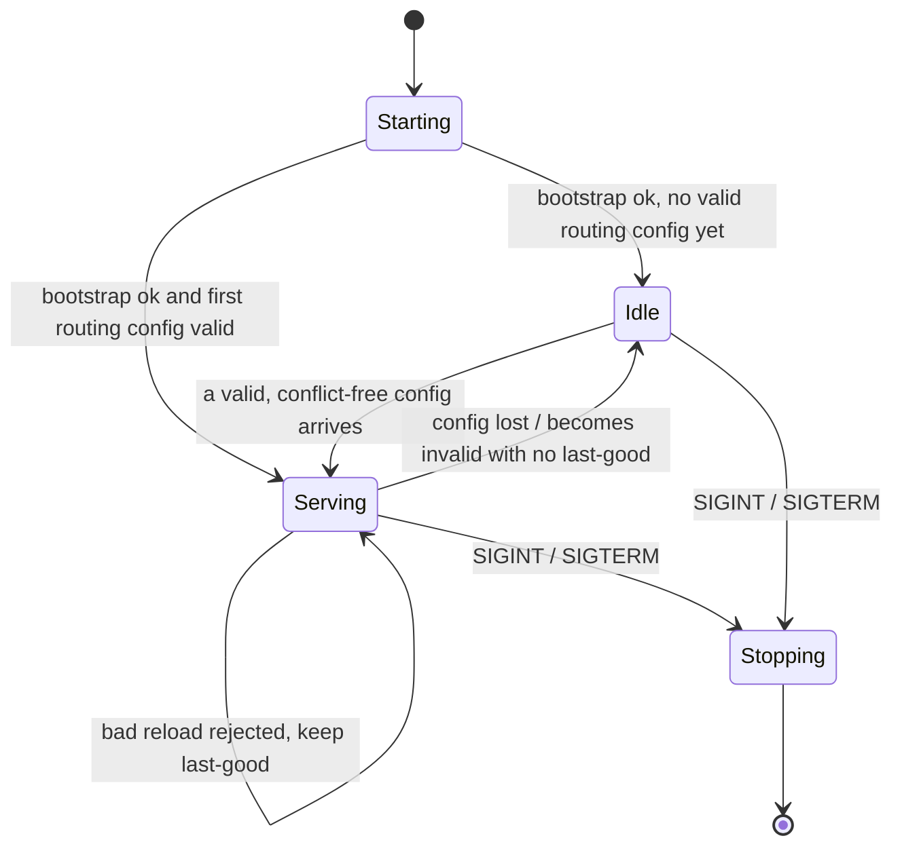
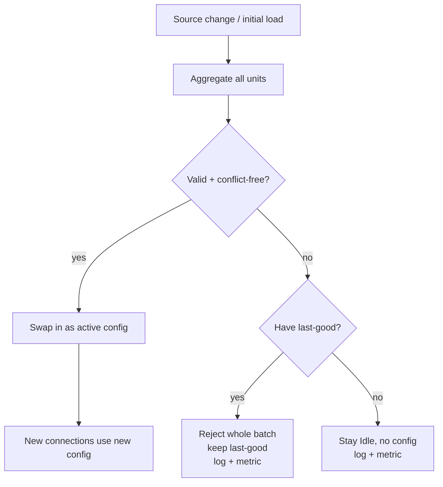
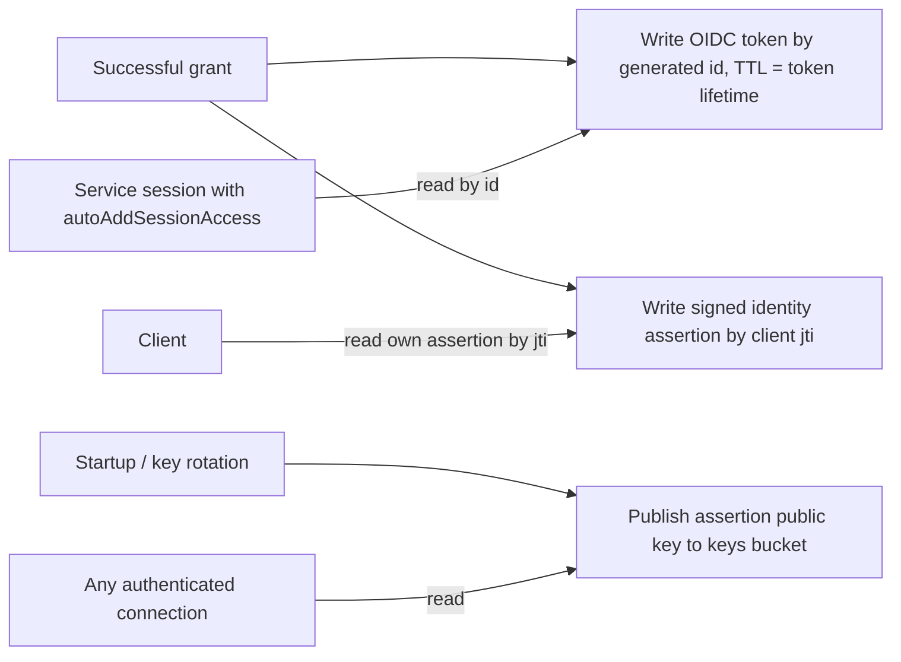
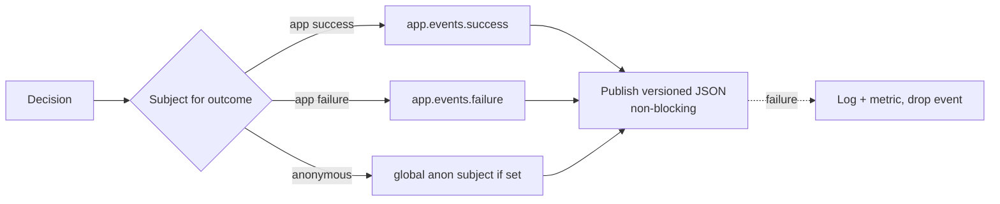
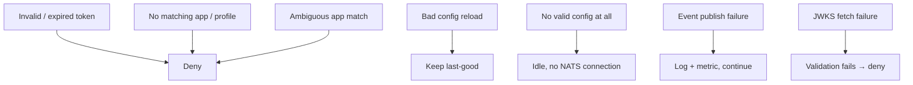

# 05 — Runtime and lifecycle

Grounds: [ADR 0006](../architecture-decision-log/0006-config-reload-and-failure-semantics.md) (reload and failure semantics), [ADR 0008](../architecture-decision-log/0008-publish-auth-outcome-events.md) (events), [ADR 0010](../architecture-decision-log/0010-session-jwt-store-in-kv.md) / [ADR 0011](../architecture-decision-log/0011-signed-identity-assertion.md) (token store, assertions), [ADR 0014](../architecture-decision-log/0014-key-rotation-orchestration.md) (assertion keyset rotation), plus observability that ties the design together.

## Service state machine

The service is only ever in one of a few states, and it holds a NATS connection only while it has a valid config.

- **Starting** — load bootstrap config, resolve secrets, select the source.
- **Idle** — no valid config. The service is up but **does not connect or subscribe to NATS at all**, and answers nothing. It waits for a valid config.
- **Serving** — holds the NATS connection, subscribes to `$SYS.REQ.USER.AUTH`, and answers requests using the current config.
- **Stopping** — graceful shutdown on signal.

The service runs on a fully valid, conflict-free config or on nothing; there is no partial-config state.

## Config load and reload

Rules (ADR 0006):

- **Reload is atomic per batch.** The whole aggregate is validated; a single bad unit rejects the entire change. A partial config is never applied.
- **New config affects new connections only.** Already-minted user JWTs keep their permissions until their own TTL expires; they cannot be revoked.
- **Bad reload with a last-good** → keep last-good, log and meter.
- **Bad or absent first config** → stay Idle with no config, log and meter, wait.

## Signing and connection identity

- The service signs every minted user JWT and every authorization response with the **issuer signing seed** (the single account signing key configured as the NATS `auth_callout` issuer). Applications differ by target account, not by signing key.
- The service authenticates its own NATS connection with the **service user seed** so it may subscribe to the callout subject, publish events, and write the token/keys KV buckets. Both seeds come from the bootstrap layer as secret references.
- When identity assertions are enabled, a separate **assertion keyset** (bootstrap secret refs, ADR 0014) signs assertions: exactly one key is active (the signer, its `kid` stamped in each assertion), the rest are verify-only, and all public keys are published to the keys bucket. The keyset rotates independently of the issuer seed via add-and-promote / overlap / retire (ADR 0011, ADR 0014).

## Identity stores (ADR 0010, 0011)

On each successful, non-anonymous authorization the service generates the connection's id and persists identity for downstream lookup, before it replies to the auth request so the client can fetch its own assertion immediately after connecting.

- **Token bucket** `callout.apps.{app-slug}.oidc-tokens.{id}`: stores the client's OIDC access token keyed by the callout-generated id, TTL matched to the token; a reconnect yields a new id and record. Readable only by profiles with `autoAddSessionAccess` for that application. Anonymous connections write no record.
- **Id-lookup bucket** `callout.apps.{app-slug}.assertions.{jti}`: stores the client's signed identity assertion, keyed by the client's token `jti` so the client can fetch its own assertion. Each client may read only its own entry.
- **Keys bucket** `callout.assertion-keys.{kid}` (plus the `current` pointer): public verification keys for the whole keyset (ADR 0014), callout is the sole writer, read access auto-granted to every authenticated connection but not to anonymous.
- **Discovery bucket** `callout.apps.{app-slug}.discovery`: per-application discovery descriptor (secret-free JSON) stating whether identity propagation is enabled and, if so, the header and bucket names plus current `kid` (ADR 0012). Callout is the sole writer; read granted per application to that application's authenticated connections, not to anonymous.

Identity propagation is **per application** (ADR 0012), default enabled. When an application disables it, the callout writes no token or assertion records for that app; keys-bucket and discovery reads are still granted, and the discovery descriptor still publishes `enabled: false` so clients and subscribers can discover this at runtime.

## Auth outcome events (ADR 0008)

Emitted best-effort after each decision; never on the critical path.

Event payload (versioned, secret-free):

- `schemaVersion`
- `timestamp`
- `outcome`: `success` | `failure`
- `reason`: a stable reason code (e.g. `anonymous`, `invalid_token`, `no_issuer_match`, `no_app_match`, `ambiguous_app`, `no_profile_match`, `grant_construction_failed`, `granted`). An anonymous grant emits `outcome: success, reason: anonymous`. `grant_construction_failed` covers denials during grant construction: a `required` template variable with no value or an unsafe transformed value (ADR 0009).
- `application`: name (absent when no application was selected)
- `profile`: matched profile name (on success)
- `principal`: identifier such as `sub` or `azp` (never the raw token)
- `issuer`
- `userNKey`

Consumers must treat the stream as best-effort, not a guaranteed-complete audit. Guaranteed audit, if ever needed, is a separate concern.

## Observability

- **Metrics** at minimum: total requests, grants by outcome, denials by reason, validation failures, config reloads (applied / rejected), events published / dropped, token-store writes / failures, JWKS fetches / cache hits, current state (idle / serving).
- **Logs**: every denial with its reason code and principal identifiers (no secrets), config load/reject with the offending unit, JWKS and NATS connection events.
- **Traces**: one span per auth request covering the four resolution stages, so latency and failure attribution are visible per stage.

## Failure posture summary

The consistent posture is **fail closed**: when in doubt, deny or serve nothing, never over-grant.
