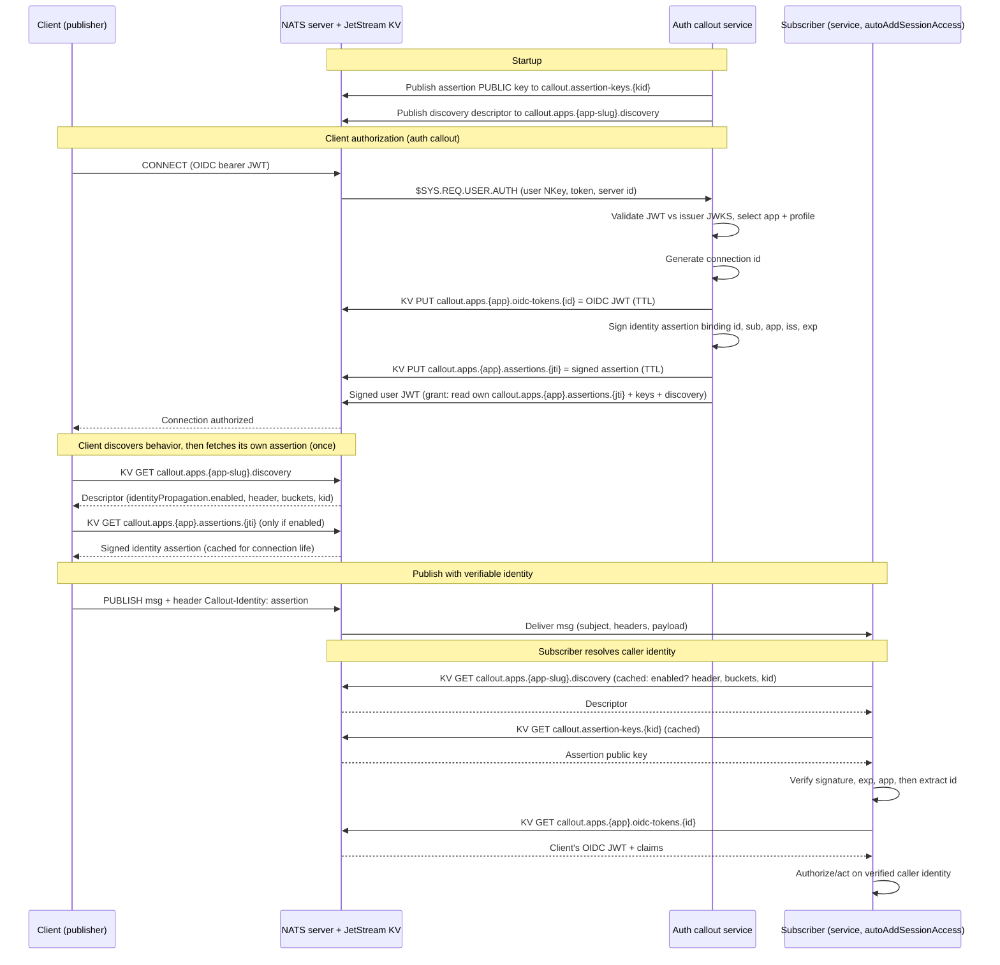

# 06 — Identity propagation sequence

How a client, subscriber, callout service, and NATS interact so a subscriber can obtain the client's OIDC JWT token. Grounds: ADR 0010 (token store keyed by a callout-generated id) and ADR 0011 (signed identity assertion). See also the identity-propagation section of [02-authorization-model.md](./02-authorization-model.md#identity-propagation-adr-0010-0011).

## How the subscriber resolves the caller's identity

The callout is never in the message path, so a delivered message exposes only its subject, headers, and payload. The subscriber reconstructs the caller's identity entirely within NATS:

1. **Read the header.** Take the `Callout-Identity` header off the received message. This is the callout-signed identity assertion (a compact JWT). A message with no valid header conveys no identity and is rejected by subscribers that require it.
2. **Fetch the verification key.** Read the assertion's `kid` header and `GET callout.assertion-keys.{kid}` from the keys bucket (cached). Only the public key is ever published there.
3. **Verify the assertion.** Check the signature against that public key, then validate `exp` (bounds replay) and `app` (scopes the assertion to one application). A forged or tampered header fails verification and is dropped.
4. **Extract the correlation id.** Trust the assertion's `id` and `sub`. The `id` is the callout-generated key into the token store, not `jti` or any provider claim.
5. **Fetch the OIDC token (only if richer claims are needed).** `GET callout.apps.{app-slug}.oidc-tokens.{id}` to retrieve the caller's full OIDC access token, then read whatever claims (`email`, `roles`, ...) the decision needs. This step requires the subscriber's profile to have `autoAddSessionAccess`, which grants read of `callout.apps.{app-slug}.oidc-tokens.>`.

Trust flows from the callout's signature on the assertion, never from the subject or a raw client-supplied value. If the subscriber only needs `id`/`sub`, steps 1-4 suffice and the token lookup in step 5 can be skipped.

Both client and subscriber first `GET callout.apps.{app-slug}.discovery` (cached) to discover whether identity propagation is enabled for the application and, if so, the header name, bucket names, and current `kid` (ADR 0012). If the descriptor says `enabled: false`, the client attaches no header and the subscriber expects none.

## Notes

- The correlation key into the token store is the callout-generated `id`, not the token's `jti`. `jti` is used only as the client's self-lookup key so it can fetch its own assertion.
- The subscriber can read the token bucket only if its profile has `autoAddSessionAccess`. Keys-bucket and discovery reads are granted to any authenticated connection, but never to the anonymous union grant.
- Identity propagation is per application and defaults to enabled (ADR 0012). When disabled, none of the store/assertion steps happen and the `callout.apps.{app-slug}.discovery` descriptor reports `enabled: false`.
- Trust comes from the callout's signature on the assertion, not from the subject or any client-settable header value.
