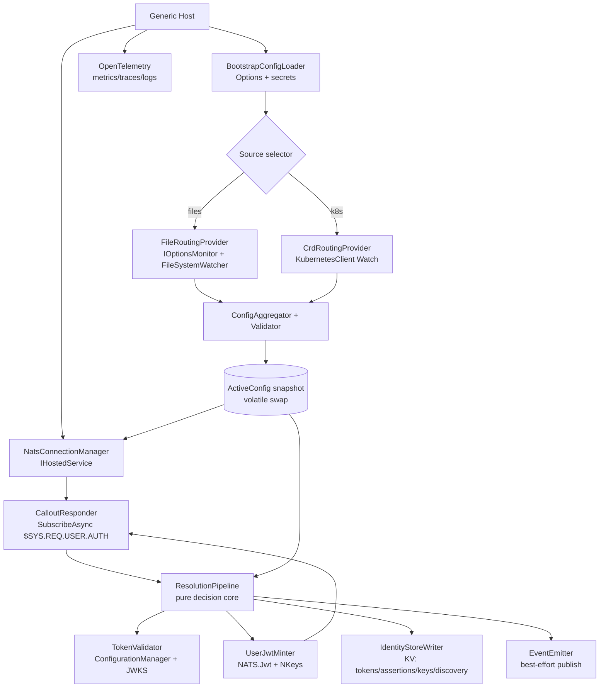

# 08 — Technical architecture (C# / .NET 10)

Concrete technology mapping for the rewrite. The language-agnostic design in [01](./01-overview.md)–[07](./07-kv-storage.md) is the contract; this document picks the .NET stack that implements it and pins the decisions that a language-neutral design leaves open. Library choices researched via Context7 against `/nats-io/nats.net` and `/kubernetes-client/csharp`.

**Target runtime:** .NET 10 (LTS). `net10.0` TFM, C# 14, nullable enabled, `Microsoft.NET.Sdk.Worker` host.

**Target NATS server:** 2.11+ (pinned). This is required for JetStream per-message TTL, which the identity stores rely on for per-record token-lifetime expiry (ADR 0010). Auth callout itself needs 2.10+, so 2.11+ covers both.

## Assumptions

- Single self-contained service process, one deployable container image (`ghcr.io/ryandanthony/nats-auth-callout-service`).
- Runs both in Kubernetes (CRD source) and standalone (files source); the process must not hard-depend on being in a cluster.
- Long-lived background worker, not an HTTP/web app — no inbound API surface beyond NATS (per [01](./01-overview.md) responsibilities).
- Config-driven, fail-closed, hot-reloadable routing config.

## Stack selection

| Concern | Choice | Package | Why |
|---------|--------|---------|-----|
| Host | Generic Host worker | `Microsoft.Extensions.Hosting` | DI, config, logging, `IHostedService` lifecycle, graceful `SIGTERM` maps to the state machine in [05](./05-runtime-and-lifecycle.md). |
| NATS transport | **NATS.Net (v2)** | `NATS.Net` | Official, actively maintained v2 client. Native async (`IAsyncEnumerable`), JetStream + KV contexts, DI extension. Supersedes the legacy `NATS.Client` v1. |
| Callout JWT | **NATS.Jwt** | `NATS.Jwt` | Decode the authorization request claims and encode/sign the authorization response + minted user JWT. |
| NKeys / signing | **NATS.NKeys** | `NATS.NKeys` | Ed25519 seed handling for the issuer signing seed, service user seed, and assertion key. |
| Kubernetes source | **KubernetesClient** | `KubernetesClient` (`/kubernetes-client/csharp`) | Official .NET client. Generic custom-object + `Watch` API for cluster-wide CRD watch with label selector. |
| OIDC/JWKS validation | `Microsoft.IdentityModel.*` | `Microsoft.IdentityModel.Protocols.OpenIdConnect`, `System.IdentityModel.Tokens.Jwt` | Standard discovery via `.well-known/openid-configuration`, `ConfigurationManager<OpenIdConnectConfiguration>` gives JWKS fetch + cache + rotation for free (matches [04](./04-configuration.md) issuer model). |
| Config binding | Options + validation | `Microsoft.Extensions.Options`, `Microsoft.Extensions.Configuration` | Bootstrap layer binding, `IValidateOptions<T>` for fail-closed validation. |
| YAML files source | YamlDotNet | `YamlDotNet` | Per-app JSON/YAML files (JSON handled by `System.Text.Json`). |
| Secrets | custom `ISecretResolver` | (in-tree) | `inline | file | k8sSecret | vault` per [04](./04-configuration.md). File + k8sSecret first; vault behind the same interface. |
| Observability | OpenTelemetry | `OpenTelemetry.Extensions.Hosting`, `.Exporter.OtlpProtocol` | Metrics + traces + logs per [05 Observability](./05-runtime-and-lifecycle.md). One span per auth request, four stage events. |
| Resilience | Polly | `Microsoft.Extensions.Http.Resilience` / `Polly` | JWKS fetch retry/timeout, k8s watch reconnect backoff. |
| Tests | xUnit + Testcontainers | `xUnit`, `Testcontainers`, `NSubstitute` | Decision layer unit-tested in isolation; integration against real `nats-server -js` and a kind/k3s CRD via Testcontainers. |

### Why NATS.Net over the legacy client

`NATS.Net` (namespace `NATS.Net` / `NATS.Client.Core`) is the v2 rewrite and the one Context7's `/nats-io/nats.net` documents. It exposes exactly the contexts this service needs off a single connection:

```csharp
await using var nc = new NatsClient(); // or NatsConnection for fine control
var js  = nc.CreateJetStreamContext();
var kv  = nc.CreateKeyValueStoreContext();   // token / assertion / keys / discovery buckets
var svc = nc.CreateServicesContext();        // optional: service discovery/metrics
```

The legacy `NATS.Client` (v1) is in maintenance mode and lacks the async KV watch surface used in [07](./07-kv-storage.md). **Do not use it.**

> Caveat worth flagging in the rewrite: auth callout in .NET is assembled from `NATS.Net` (subscribe/reply on `$SYS.REQ.USER.AUTH`) + `NATS.Jwt` + `NATS.NKeys`. There is no single high-level "callout server" helper as of the current releases (`NATS.Jwt` 1.0.x, `NATS.NKeys` 1.0.x are recent/preview). Budget time for a thin callout adapter and pin package versions.

## Process composition



Only the k8s and files providers touch source-specific types; both map into the canonical model from [04](./04-configuration.md) before the pipeline sees them. `KubernetesClient` is referenced only by `CrdRoutingProvider`, keeping the cluster dependency out of the decision core (satisfies [ADR 0005](../architecture-decision-log/0005-config-abstraction-and-sources.md)).

## Project layout

```
src/
  AuthCallout.Host/            # Program.cs, DI wiring, Worker, health
  AuthCallout.Core/            # decision core: pipeline, selectors, matcher, minter (no I/O deps)
  AuthCallout.Contracts/       # canonical config model, Grant, ClaimMatch, SecretRef
  AuthCallout.Nats/            # NatsConnectionManager, CalloutResponder, IdentityStoreWriter, EventEmitter
  AuthCallout.Identity/        # TokenValidator, JwksProvider, AssertionSigner
  AuthCallout.Config.Files/    # FileRoutingProvider (+ YamlDotNet)
  AuthCallout.Config.K8s/      # CrdRoutingProvider (+ KubernetesClient) — isolated
  AuthCallout.Secrets/         # ISecretResolver + inline/file/k8s/vault impls
tests/
  AuthCallout.Core.Tests/      # pure, fast, no containers
  AuthCallout.Integration/     # Testcontainers: nats-server -js, k3s CRD
deploy/
  crd/                         # CustomResourceDefinition + RBAC (ClusterRole/Binding)
  helm/ or kustomize/
```

`AuthCallout.Core` and `AuthCallout.Contracts` reference no transport, storage, or k8s packages, so the whole authorization model is exercisable in isolation (matches the design's "Decision components contain no transport or storage code").

## Auth callout implementation shape

```csharp
// CalloutResponder — Serving state only
await foreach (var msg in nc.SubscribeAsync<byte[]>("$SYS.REQ.USER.AUTH", cancellationToken: ct))
{
    var request = NatsAuthorizationRequest.Decode(msg.Data);      // NATS.Jwt
    var decision = await pipeline.ResolveAsync(request, activeConfig.Current, ct);

    var responseJwt = decision switch
    {
        Grant g  => minter.MintUserJwt(g, request.UserNKey, issuerSeed),   // NATS.Jwt + NKeys
        Deny d   => minter.MintDenial(request, d.Reason),
    };

    await msg.ReplyAsync(responseJwt, cancellationToken: ct);      // signed authorization response
    _ = events.EmitAsync(decision);                               // best-effort, off critical path
}
```

The minter signs both the user JWT and the authorization response with the issuer signing seed (loaded once from a `SecretRef`, [05](./05-runtime-and-lifecycle.md)).

## KV / identity stores (maps [07](./07-kv-storage.md) to NATS.Net KV)

```csharp
var kv = nc.CreateKeyValueStoreContext();
var tokens = await kv.CreateStoreAsync(new NatsKVConfig($"callout_apps_{slug}_oidc_tokens")
{
    // TTL matched to token lifetime per ADR 0010
});
await tokens.PutAsync(connectionId, oidcToken, ct);

// keys bucket watch for rotation / discovery consumers
await foreach (var e in keysStore.WatchAsync<string>(">", cancellationToken: ct))
{ /* react to rotation */ }
```

- Bucket names: KV bucket names cannot contain `.`, so the dotted subject paths in [07](./07-kv-storage.md)/[ADR 0010](../architecture-decision-log/0010-session-jwt-store-in-kv.md) become bucket name (`callout_apps_{slug}_oidc_tokens`) + key. Decide and pin the slug→bucket mapping once; it is an interop contract with consumers.
- Per-entry TTL: on the pinned 2.11+ server, use JetStream **per-message TTL** so each token record expires at its own token lifetime (ADR 0010), rather than a coarse bucket-wide `MaxAge`. The bucket may still set a `MaxAge` ceiling as a backstop.

## Kubernetes CRD source

```csharp
var config = KubernetesClientConfiguration.InClusterConfig();     // or BuildConfigFromConfigFile()
var client = new Kubernetes(config);

// cluster-wide watch, label selector claims owned CRs (ADR 0005)
var resp = client.CustomObjects.ListClusterCustomObjectWithHttpMessagesAsync(
    group: "authcallout.ants.zone", version: "v1", plural: "authapplications",
    labelSelector: ownerSelector, watch: true);

await foreach (var (type, item) in resp.WatchAsync<AuthApplication, object>(ct))
{
    // type: Added / Modified / Deleted -> re-aggregate + validate whole batch
}
```

- Watch must handle `410 Gone` (resource version expired) by relisting, and reconnect with backoff (Polly). A dropped watch that silently stops is a fail-open risk — treat watch loss as "config source unhealthy".
- RBAC: `ClusterRole` granting `list`/`watch`/`get` on the CRD cluster-wide, a `ServiceAccount`, and a `ClusterRoleBinding`. Ship in `deploy/crd/`.

## Config reload → in-memory swap

Active config is a single immutable snapshot behind a `volatile` reference (or `IOptionsMonitor`-style change token). Providers push a validated aggregate; `ConfigAggregator` validates the whole batch atomically ([05](./05-runtime-and-lifecycle.md) rules) and does one reference swap. In-flight requests keep their snapshot; new requests read the new one. No lock on the hot path.

## What you're missing (gaps the language-neutral design leaves open)

These are not in [01](./01-overview.md)–[07](./07-kv-storage.md) and should be decided before or during the rewrite:

1. **KV bucket naming contract.** Dotted subjects can't be bucket names; the slug→bucket mapping is a consumer-facing interface. Defined in [ADR 0013](../architecture-decision-log/0013-kv-bucket-naming-contract.md).
2. **Health & readiness.** The service has no HTTP surface, but k8s wants liveness/readiness. Add a minimal `/healthz` `/readyz` (map `readyz` to the `Serving` state) via `Microsoft.Extensions.Diagnostics.HealthChecks`, or a NATS-based health check. Not covered by current design.
3. **Watch-loss = fail-closed semantics.** [05](./05-runtime-and-lifecycle.md) covers bad config, not a silently dead k8s watch or lost NATS connection. Define: lost NATS connection → stop answering (already implied); dead config watch → keep last-good but alert, with a staleness bound.
4. **Concurrency / backpressure.** Auth callout is on the client connect path. Define max in-flight auth requests, per-request timeout, and JWKS-fetch timeout so a slow IdP can't stall connects. Polly + bounded channel.
5. **Clock skew / token validation params.** `ClockSkew`, allowed algorithms (reject `none`/HS* when expecting RS/ES), `ValidateAudience` defaults per [04](./04-configuration.md). Make these explicit.
6. **Key rotation orchestration.** [05](./05-runtime-and-lifecycle.md) says the assertion key rotates independently; define the rotation trigger, overlap window (publish new `kid` before retiring old), and how the issuer seed rotates (server config coupling).
7. **Multi-instance behavior.** Cluster-wide CRD watch + label selector implies multiple instances can share a cluster. Confirm: are two instances answering the same callout account HA/active-active, and is that safe (idempotent KV writes, duplicate events)? Events stream is best-effort so duplicates are OK; confirm KV writes are last-writer-wins safe.
8. **Supply chain / build.** .NET 10 container via `Microsoft.NET.Build.Containers` or Dockerfile, trimming/AOT decision (NKeys/crypto + reflection-based config binding may block full AOT — likely trimmed, not AOT). SBOM + image signing to match your GHCR flow.
9. **Schema versioning for events + CRD.** Event `schemaVersion` exists ([05](./05-runtime-and-lifecycle.md)); the CRD needs its own `apiVersion` evolution story (v1 → v1beta conversions) and the discovery descriptor schema needs a version too.
10. **Local dev / no-k8s story.** Files source + a `docker-compose` with `nats-server -js` + Keycloak for a full loop, so the decision core is runnable without a cluster.

## Validation / feedback loop for the rewrite

- Unit: decision core (selectors, matcher, template variables, anonymous union) with table-driven claim fixtures — no containers, sub-second.
- Integration: Testcontainers boots `nats:2.11 -js`; assert a real client with a Keycloak-issued token connects and is granted the expected subjects, KV buckets populated, events observed.
- Contract: golden tests for canonical-model mapping from both files and CRD shapes so a source can't drift from the core.

## Sources

- NATS .NET: Context7 `/nats-io/nats.net` (KV `CreateStoreAsync`/`WatchAsync`, `NatsClient` contexts, Services API).
- Auth callout JWT/NKeys: `NATS.Jwt` 1.0.x, `NATS.NKeys` 1.0.x (NuGet); auth callout concept — <https://docs.nats.io/learn/security/auth-callout>.
- Kubernetes .NET: Context7 `/kubernetes-client/csharp` (`InClusterConfig`, custom objects, `Watch`).
