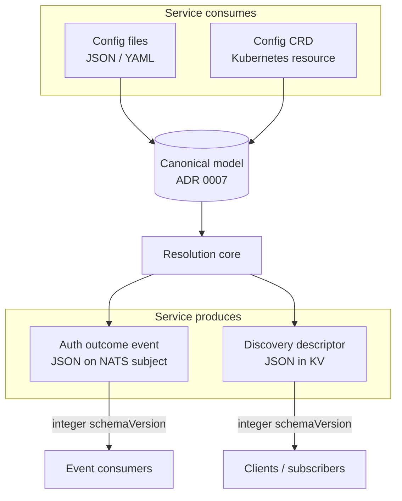

# 09 — Schemas and versioning

The concrete, field-level schemas for every externally-visible shape the service produces or consumes, and how each is versioned. Grounds: [ADR 0015](../architecture-decision-log/0015-schema-versioning-strategy.md) (versioning strategy), [ADR 0007](../architecture-decision-log/0007-internal-configuration-model.md) (canonical model both config sources map into), [ADR 0008](../architecture-decision-log/0008-publish-auth-outcome-events.md) (events), [ADR 0012](../architecture-decision-log/0012-identity-propagation-toggle-and-discovery.md) (discovery descriptor).

Four surfaces, two versioning idioms ([ADR 0015](../architecture-decision-log/0015-schema-versioning-strategy.md)):



- **Payload surfaces** (events, discovery, files): integer `schemaVersion`. Additive changes keep the version; breaking changes bump it. Consumers ignore unknown fields and gate on version.
- **CRD**: Kubernetes `apiVersion`, converted by the API server to the canonical model.

## 1. Auth outcome event

Published best-effort per decision ([ADR 0008](../architecture-decision-log/0008-publish-auth-outcome-events.md)); secret-free. Subject is the per-application `events.success` / `events.failure` (or the global anonymous subject).

### Current version: `schemaVersion: 1`

```json
{
  "schemaVersion": 1,
  "timestamp": "2026-09-06T22:00:00Z",
  "outcome": "success",
  "reason": "granted",
  "application": "notes",
  "profile": "editor",
  "principal": "user@example.com",
  "issuer": "https://id.ants.zone/realms/main",
  "userNKey": "UED..."
}
```

| Field | Type | Required | Notes |
|-------|------|----------|-------|
| `schemaVersion` | integer | yes | `1`. Consumers reject unknown majors. |
| `timestamp` | RFC 3339 string | yes | Decision time, UTC. |
| `outcome` | enum | yes | `success` \| `failure`. |
| `reason` | enum string | yes | Stable reason code: `no_token`, `invalid_token`, `no_issuer_match`, `no_app_match`, `ambiguous_app`, `no_profile_match`, `granted`. New codes are **additive** (no bump); consumers treat unknown codes as generic failure. |
| `application` | string | no | Absent when no application was selected. |
| `profile` | string | no | Present on success. |
| `principal` | string | no | `sub`/`azp`-style identifier, never the raw token. |
| `issuer` | string | no | Original OIDC issuer. |
| `userNKey` | string | no | The connection's user NKey. |

JSON Schema (`$id: .../events/auth-outcome/v1.json`) is shipped in `schemas/events/` and used by consumer contract tests. `additionalProperties: true` so v1 consumers survive additive changes.

## 2. Discovery descriptor

Published per application to `callout_apps_{slug}_discovery` ([ADR 0012](../architecture-decision-log/0012-identity-propagation-toggle-and-discovery.md), [ADR 0013](../architecture-decision-log/0013-kv-bucket-naming-contract.md) for physical names); secret-free.

### Current version: `schemaVersion: 1`

Identity propagation enabled:

```json
{
  "schemaVersion": 1,
  "app": "notes",
  "identityPropagation": {
    "enabled": true,
    "header": "Callout-Identity",
    "oidcTokenBucket": "callout_apps_notes_oidc_tokens",
    "assertionBucket": "callout_apps_notes_assertions",
    "assertionKeysBucket": "callout_assertion_keys",
    "currentKid": "2026-09-06a"
  }
}
```

Identity propagation disabled:

```json
{ "schemaVersion": 1, "app": "notes", "identityPropagation": { "enabled": false } }
```

| Field | Type | Required | Notes |
|-------|------|----------|-------|
| `schemaVersion` | integer | yes | `1`. |
| `app` | string | yes | Application slug. |
| `identityPropagation.enabled` | bool | yes | Master toggle ([ADR 0012](../architecture-decision-log/0012-identity-propagation-toggle-and-discovery.md)). |
| `identityPropagation.header` | string | when enabled | Message header name (`Callout-Identity`). |
| `identityPropagation.oidcTokenBucket` | string | when enabled | Physical bucket name ([ADR 0013](../architecture-decision-log/0013-kv-bucket-naming-contract.md)). |
| `identityPropagation.assertionBucket` | string | when enabled | Physical bucket name. |
| `identityPropagation.assertionKeysBucket` | string | when enabled | Physical bucket name. |
| `identityPropagation.currentKid` | string | when enabled | Active assertion `kid` ([ADR 0014](../architecture-decision-log/0014-key-rotation-orchestration.md)). |

Bucket names here are the **physical** names from [ADR 0013](../architecture-decision-log/0013-kv-bucket-naming-contract.md) (updated from the dotted illustrative names in ADR 0012). The descriptor is the authoritative runtime source of these names for consumers.

## 3. Config files (JSON/YAML)

One file per application ([ADR 0005](../architecture-decision-log/0005-config-abstraction-and-sources.md)); a directory of them is the files source. YAML and JSON are interchangeable (same shape). Each file declares `schemaVersion`.

### Current version: `schemaVersion: 1`

```yaml
schemaVersion: 1
name: notes                       # unique across the aggregate
targetAccount: NOTES
issuer:
  authority: https://id.ants.zone/realms/main
  jwksUri: null                   # optional override; else OIDC discovery
  jwksCacheSeconds: 300
  validateAudience: true
  audience: nats
match:                            # optional app selector among same-issuer apps
  azp: [notes-web]
identityPropagation:
  enabled: true
anonymousProfile:                 # optional contribution to the anonymous union
  publish: []
  subscribe: [notes.public.>]
events:
  success: notes.events.auth.success
  failure: notes.events.auth.failure
profiles:
  - name: editor
    match:
      realm_access.roles: [notes-editor]
    grant:
      publish: [notes.{tenant}.>]
      subscribe: [notes.{tenant}.>]
    nameClaim: sub
    autoAddSessionAccess: false
    fallbackExpirySeconds: 3600
    variables:
      - name: tenant
        claim: tenant_id
        required: true
        transforms: [lowercase, sanitize]
    publishTemplates: ["notes.{tenant}.outbox.>"]
    subscribeTemplates: ["notes.{tenant}.inbox.>"]
```

Field semantics are the canonical **Application**/**Profile** model in [04 — Configuration](./04-configuration.md#canonical-model-adr-0007); this schema is that model plus a `schemaVersion` header. Secrets (seeds) are **not** in per-app files; they live in the bootstrap layer as `SecretRef`s ([04](./04-configuration.md)).

| Rule | Behavior |
|------|----------|
| `schemaVersion` present and supported | Mapped to canonical model, aggregated, validated ([ADR 0006](../architecture-decision-log/0006-config-reload-and-failure-semantics.md)). |
| `schemaVersion` newer than supported | File rejected, whole batch rejected, keep last-good, log + metric. |
| `schemaVersion` missing | Treated as `1` during the migration window, then rejected (fail closed). |
| Unknown extra fields | Rejected at v1 (strict) for authored config, to catch typos early — unlike wire payloads, operator config is validated strictly. |

A JSON Schema (`schemas/config/application/v1.json`) validates files in CI and can back editor autocompletion.

### Bootstrap file

The bootstrap layer ([04](./04-configuration.md)) is a separate, non-hot-reloaded file, also `schemaVersion`ed:

```yaml
schemaVersion: 1
natsUrl: nats://nats:4222
issuerSeed:        { kind: file, path: /secrets/issuer.seed }
serviceUserSeed:   { kind: k8sSecret, name: callout-svc, key: seed }
assertionKeys:                       # keyset, ADR 0014
  - kid: 2026-09-06a
    key: { kind: file, path: /secrets/assert-a.seed }
    active: true
  - kid: 2026-08-01a
    key: { kind: file, path: /secrets/assert-old.seed }
    active: false
source:
  kind: files                        # or k8s
  directory: /config/apps
anonymous:
  targetAccount: ANON
  expirySeconds: 300
  events: { success: anon.auth.success, failure: anon.auth.failure }
```

## 4. Kubernetes CRD

The k8s source ([ADR 0005](../architecture-decision-log/0005-config-abstraction-and-sources.md)): one Custom Resource per application, watched cluster-wide, each claimed by label selector. Uses Kubernetes `apiVersion`, not an integer `schemaVersion` ([ADR 0015](../architecture-decision-log/0015-schema-versioning-strategy.md)).

- **Group:** `authcallout.ants.zone`
- **Kind:** `AuthApplication`
- **Served versions:** `v1` (add `v1alpha1`/`v1beta1` only if a pre-stable shape is needed first)
- **Scope:** Namespaced (CRs may live in any namespace; the instance claims those matching its owner label)

### Custom Resource (`apiVersion: authcallout.ants.zone/v1`)

```yaml
apiVersion: authcallout.ants.zone/v1
kind: AuthApplication
metadata:
  name: notes
  namespace: notes
  labels:
    authcallout.ants.zone/owner: prod   # the instance's ownership selector
spec:
  targetAccount: NOTES
  issuer:
    authority: https://id.ants.zone/realms/main
    jwksCacheSeconds: 300
    validateAudience: true
    audience: nats
  match:
    azp: [notes-web]
  identityPropagation:
    enabled: true
  anonymousProfile:
    subscribe: [notes.public.>]
  events:
    success: notes.events.auth.success
    failure: notes.events.auth.failure
  profiles:
    - name: editor
      match: { realm_access.roles: [notes-editor] }
      grant:
        publish: [notes.{tenant}.>]
        subscribe: [notes.{tenant}.>]
      nameClaim: sub
      autoAddSessionAccess: false
      fallbackExpirySeconds: 3600
      variables:
        - name: tenant
          claim: tenant_id
          required: true
          transforms: [lowercase, sanitize]
      publishTemplates: ["notes.{tenant}.outbox.>"]
      subscribeTemplates: ["notes.{tenant}.inbox.>"]
status:
  observedGeneration: 4
  accepted: true
  reason: ""                          # populated when accepted=false
```

`spec` is the same canonical **Application** as the file schema, minus the file's `schemaVersion`/`name` (the CR's `metadata.name` is the application name). The CRD's OpenAPI v3 `validation` schema enforces required fields at admission time, so a malformed CR is rejected by the API server before the service sees it.

### `status` subresource

The service writes back a `status` so `kubectl get authapplication` shows whether a CR was accepted into the active config ([ADR 0006](../architecture-decision-log/0006-config-reload-and-failure-semantics.md) validation): `accepted`, `reason` (on rejection), and `observedGeneration`. A rejected CR does not take down the batch's other apps only if it is isolatable; per [ADR 0006](../architecture-decision-log/0006-config-reload-and-failure-semantics.md) the aggregate is atomic, so a bad CR rejects the batch and its `status.accepted=false` names the offender.

### CRD evolution

- v1 is the storage and served version until a breaking change is needed.
- A second version (`v2`) is added as served + a **conversion** (webhook or, for simple field renames, a none-strategy with defaulting) to the storage version; Kubernetes converts on read/write.
- The service's provider deserializes the storage version into the canonical model; it never branches on served version.
- Deprecated fields survive at least one served version, per Kubernetes convention.

## Schema artifacts in the repo

```
schemas/
  events/auth-outcome/v1.json          # JSON Schema, consumer contract tests
  discovery/descriptor/v1.json         # JSON Schema
  config/application/v1.json           # JSON Schema for files (strict)
  config/bootstrap/v1.json             # JSON Schema for bootstrap file
deploy/crd/
  authapplication-crd.yaml             # CustomResourceDefinition (OpenAPI v3 validation)
```

Contract/golden tests assert the emitted event and descriptor validate against their JSON Schema, and that both the file schema and the CRD `spec` map to the identical canonical model for equivalent input ([ADR 0007](../architecture-decision-log/0007-internal-configuration-model.md)), so the two config sources cannot diverge.

## Related

- ADRs: [0005](../architecture-decision-log/0005-config-abstraction-and-sources.md), [0006](../architecture-decision-log/0006-config-reload-and-failure-semantics.md), [0007](../architecture-decision-log/0007-internal-configuration-model.md), [0008](../architecture-decision-log/0008-publish-auth-outcome-events.md), [0012](../architecture-decision-log/0012-identity-propagation-toggle-and-discovery.md), [0013](../architecture-decision-log/0013-kv-bucket-naming-contract.md), [0014](../architecture-decision-log/0014-key-rotation-orchestration.md), [0015](../architecture-decision-log/0015-schema-versioning-strategy.md).
- Design: [04 — Configuration](./04-configuration.md), [05 — Runtime and lifecycle](./05-runtime-and-lifecycle.md), [07 — KV storage](./07-kv-storage.md), [08 — Technical architecture (C#)](./08-technical-architecture-csharp.md).
