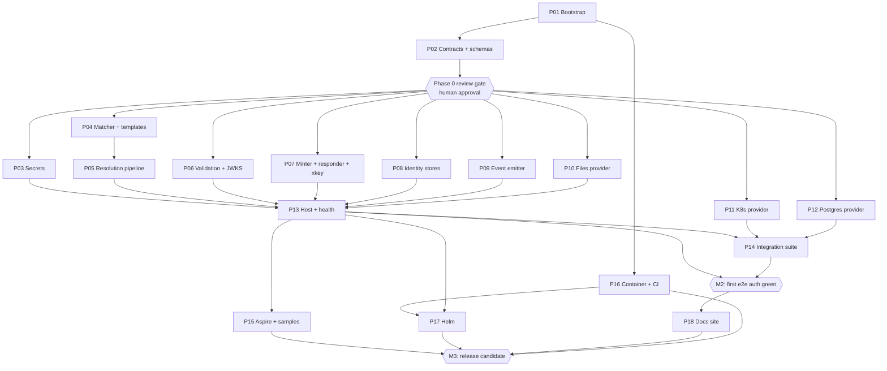

# Implementation Plan — nats-auth-callout-service

Execution plan for building the service described in `docs/design/01–09` and
ADRs 0001–0017, structured for **parallel execution by up to 6 Sonnet-class
worker agents via jcode swarm**, coordinated by one coordinator agent. All
scope/process decisions were resolved in [`../QUESTIONS.md`](../QUESTIONS.md);
this plan encodes them.

## Decisions in force (from QUESTIONS.md)

| # | Decision |
|---|----------|
| A1 | Plan the **complete design** now; milestones gate integration only, not scope. |
| A2 | Database config source **in scope**: PostgreSQL + Dapper. |
| A3 | Helm chart in scope (`deploy/helm/`). |
| A4 | User/operator docs site in scope, published to `ryandanthony.github.io` (style: [dottie docs](https://ryandanthony.github.io/dottie/)). |
| B5–B9 | Phase 0 bootstrap packet first; conventions from `festina-lente-io/code-standards` NuGet + mise repo files; CI (build + tests) from day one; **direct-to-main** commits; central package management with **pinned** versions. |
| C10–C13 | Contracts frozen after Phase 0 (changes need coordinator approval); interface list per packet 02; **two** reason enums (internal `DenyReason`, wire event `reason`) with an explicit mapping; four JSON Schemas authored in Phase 0. |
| D14 | xkey callout encryption **implemented**, plus **ADR 0018** documenting the decision. |
| D15 | Anonymous with zero `anonymousProfile` contributions = **deny**. |
| D16 | Callout **creates** KV buckets at config-apply. (Removal: leave orphaned, log + warning metric — assumption, flag if wrong.) |
| D17 | Token record TTL = token `exp` exactly, **no MaxAge backstop**. |
| D18 | Minted user JWT carries the minimum: account, name, exp, pub/sub allow lists. |
| D19 | Missing `nameClaim` → fall back to `sub`. |
| D20 | Assertion format documented in design docs, **not** a separate schema artifact. |
| D21 | Pinned now: health port **8080**, `/healthz` `/readyz` `/startupz`. |
| D22 | OTel service name + OTLP endpoint configurable at deployment time (env). |
| E23–E25 | Real Keycloak via Testcontainers in CI; k3s via Testcontainers in CI; **90% line coverage on `AuthCallout.Core`** enforced. |
| F27–F29 | Max 6 parallel workers; human review gate at end of Phase 0 then review-by-exception; one plan file per packet. |

## Packet index

| Packet | File | Project(s) owned | Wave |
|--------|------|------------------|------|
| P01 Bootstrap | [01-bootstrap.md](./01-bootstrap.md) | repo root, CI, sln | 0 |
| P02 Contracts + schemas | [02-contracts-and-schemas.md](./02-contracts-and-schemas.md) | `AuthCallout.Contracts`, `schemas/` | 0 |
| P03 Secrets | [03-secrets.md](./03-secrets.md) | `AuthCallout.Secrets` | 1 |
| P04 Claim matcher + templates | [04-claim-matching-and-templates.md](./04-claim-matching-and-templates.md) | `AuthCallout.Core` (matcher/template files) | 1 |
| P05 Resolution pipeline | [05-resolution-pipeline.md](./05-resolution-pipeline.md) | `AuthCallout.Core` (pipeline/selector files) | 2 |
| P06 Token validation + JWKS | [06-token-validation-and-jwks.md](./06-token-validation-and-jwks.md) | `AuthCallout.Identity` (validator/JWKS files) | 1 |
| P07 Minter + responder + xkey | [07-minter-responder-xkey.md](./07-minter-responder-xkey.md) | `AuthCallout.Nats` (responder/minter files), ADR 0018 | 2 |
| P08 Identity stores + assertions | [08-identity-stores-and-assertions.md](./08-identity-stores-and-assertions.md) | `AuthCallout.Nats` (store writer), `AuthCallout.Identity` (assertion signer) | 2 |
| P09 Event emitter | [09-event-emitter.md](./09-event-emitter.md) | `AuthCallout.Nats` (emitter files) | 1 |
| P10 Files config provider | [10-config-files-provider.md](./10-config-files-provider.md) | `AuthCallout.Config.Files` | 1 |
| P11 K8s CRD provider | [11-config-k8s-provider.md](./11-config-k8s-provider.md) | `AuthCallout.Config.K8s`, `deploy/crd/` | 1 |
| P12 PostgreSQL provider | [12-config-db-provider.md](./12-config-db-provider.md) | `AuthCallout.Config.Postgres` | 1 |
| P13 Host, health, lifecycle | [13-host-health-lifecycle.md](./13-host-health-lifecycle.md) | `AuthCallout.Host` | 2 |
| P14 Integration suite | [14-integration-suite.md](./14-integration-suite.md) | `tests/AuthCallout.Integration` | 3 |
| P15 Aspire dev loop + samples | [15-aspire-dev-loop.md](./15-aspire-dev-loop.md) | `dev/` | 3 |
| P16 Container + CI + supply chain | [16-container-ci-supply-chain.md](./16-container-ci-supply-chain.md) | `Dockerfile`, release workflows | 1 |
| P17 Helm chart | [17-helm-chart.md](./17-helm-chart.md) | `deploy/helm/` | 3 |
| P18 Docs site | [18-docs-site.md](./18-docs-site.md) | `docs-site/` (or repo pattern from dottie) | 3 |

## Dependency graph

Waves are scheduling guidance, not hard barriers: a worker may start any packet
whose dependencies have landed. With 6 workers, Wave 1 has 8 eligible packets
(P03, P04, P06, P09, P10, P11, P12, P16) — the coordinator assigns the 6
longest first (suggested order: P06, P11, P10, P04, P12, P16, then P03, P09 as
workers free up).

## Milestones (integration gates, not scope gates)

- **M0 — Contracts frozen.** P01 + P02 merged, CI green, **human review** of
  `AuthCallout.Contracts` and the four JSON Schemas. Only gate requiring Ryan.
- **M1 — Components green.** All Wave 1–2 packets merged, unit + contract
  tests green, `AuthCallout.Core` coverage ≥ 90%.
- **M2 — First end-to-end auth.** Integration suite proves: real client +
  Keycloak token → callout → granted subjects enforced, KV populated, event
  observed. Reported to Ryan (review by exception).
- **M3 — Release candidate.** Signed image, Helm chart installs, Aspire loops
  run, docs site builds. Tag `v0.1.0`.

## Swarm protocol

### Roles

- **Coordinator** (root session): assigns packets, merges/rebases, owns
  `AuthCallout.Contracts` changes, runs the plan, resolves conflicts,
  **reviews every packet on completion** (see Coordinator code review below),
  and reports at milestones. Does not implement packets while workers are
  active.
- **Workers** (max 6): one packet at a time, complete it, report
  status + validation, take the next.

### Ground rules for every worker

1. **Read first:** this overview, your packet file, and every design doc/ADR
   your packet lists. The design docs are the contract; where docs conflict,
   `docs/design/07-kv-storage.md` wins for KV facts, ADRs win for rationale.
2. **File ownership is absolute.** Touch only the paths in your packet's
   "Files owned". Shared files (`Directory.Packages.props`, sln) are
   coordinator-mediated: DM the coordinator with the exact change you need.
3. **Contracts are frozen.** If your packet cannot be built against
   `AuthCallout.Contracts` as-is, stop, DM the coordinator with the proposed
   interface change and why. Do not edit Contracts yourself.
4. **Commit direct to `main`**, small commits, prefix `P##:` (e.g.
   `P06: JwksCacheManager prewarm ordering`). Pull/rebase before each commit.
5. **Definition of done** (every packet): code + XML docs on public surface,
   unit tests green locally, `dotnet build -warnaserror` clean,
   `dotnet format --verify-no-changes` clean, packet's DoD checklist satisfied,
   `swarm report` with validation evidence.
6. **Stubs over blocking.** If a dependency packet hasn't landed, code against
   the Contracts interface and test with substitutes (NSubstitute). Never
   hand-roll a temporary interface.
7. **No design changes.** Anything that contradicts a design doc or ADR is a
   coordinator escalation, not a local fix.

### Coordinator code review (every packet)

Direct-to-main keeps workers unblocked, so review happens **post-landing but
pre-acceptance**. On each worker's `swarm report`, the coordinator reviews the
packet's commits before marking the packet accepted:

1. **Acceptance criteria first.** Walk the packet file's Definition of done
   and ADR→test map line by line against the actual diff and test output: is
   each DoD item demonstrably satisfied, and does every ADR→test row have a
   real, meaningful test (not a placeholder that asserts nothing)?
2. **Design fidelity.** Spot-check the code against the design docs/ADRs the
   packet cites — the failure mode DoD checklists miss is code that passes its
   own tests but diverges from a doc the worker skimmed.
3. **Boundary compliance.** Files-owned respected, no Contracts edits, no
   forbidden package references (doc 08 isolation invariants), no shared-file
   changes that weren't coordinator-mediated.
4. **Verdict.** Pass → packet **accepted**, dependents may start. Findings →
   fix-up task back to the same worker; the packet stays unaccepted (and
   dependents are held where feasible) until re-review passes. Disputes about
   the design itself escalate to Ryan (review by exception).

Every packet's Definition of done implicitly ends with **"coordinator review
passed"**; a `swarm report` is a review request, not an acceptance.

### Testing bar

- Unit tests colocated per packet in `tests/AuthCallout.Core.Tests` (or the
  packet's own test project). Table-driven tests for every ADR-specified
  behavior your packet implements (each packet file lists its ADR→test map).
- **Coverage:** ≥ 90% line coverage on `AuthCallout.Core`, enforced in CI
  (coverlet threshold). Other projects: no hard gate, but the ADR→test map is
  mandatory.
- Contract/golden tests validate emitted JSON against `schemas/*` and assert
  files/CRD/DB rows map to the identical canonical model (ADR 0007).
- Integration (P14) uses Testcontainers: `nats:2.11 -js`, Keycloak, k3s,
  Postgres — all acceptable in GitHub Actions (Docker available on
  `ubuntu-latest`).

### Conventions (pinned in P01)

- .NET 10 (`net10.0`), C# 14, nullable, warnings as errors, StyleCop +
  `festina-lente-io/code-standards` package.
- Central package management, exact pins (`NATS.Net`, `NATS.Jwt` 1.0.x,
  `NATS.NKeys` 1.0.x, `KubernetesClient`, `Microsoft.IdentityModel.*`,
  `YamlDotNet`, `Dapper`, `Npgsql`, OTel, Polly, xUnit, Testcontainers,
  NSubstitute, Alba).
- GitVersion (config seeded from `ryandanthony/mcp-private-library`).
- Health: port **8080**, `/healthz` (live), `/readyz` (ready), `/startupz`
  (startup). OTel service name + OTLP endpoint via env
  (`OTEL_SERVICE_NAME`, `OTEL_EXPORTER_OTLP_ENDPOINT`).
